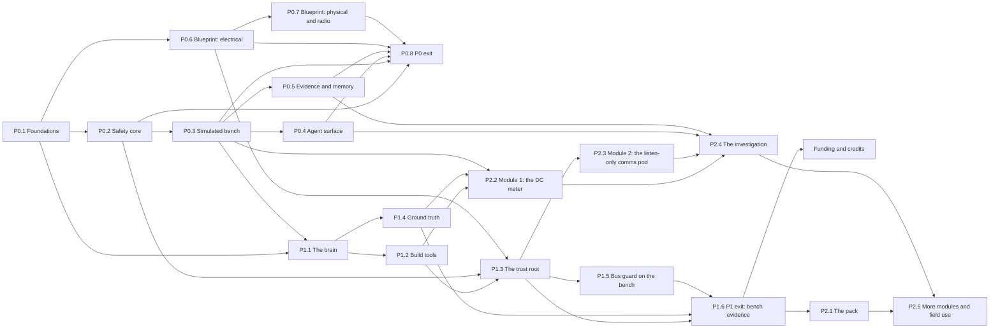

# Roadmap

The project is cut into numbered stages. Each stage ends in a **check-in**: a short list of things the owner can see working, and the decisions that are his to make. A stage is done when its check-in is closed.

There are no dates. Order comes from what each stage needs first. Live progress is on the [milestones page](https://github.com/rafe-walker/sawbones-labs/milestones) and in the [project](https://github.com/users/rafe-walker/projects/2), view "By phase".

- **P0** is everything that can be built and proved without hardware: software, firmware logic, and the blueprints, tested in simulation.
- **P1, Prove the Interlock on the bench,** is only the hardware needed to prove the safety design on a bench. Nothing is built for the field in P1.
- **Funding and credits** comes after P1, once there is bench evidence to show. It does not start before P1 exits.
- **P2, Make it mobile,** is everything else from the old Bench Core and the later phases: the pack, the modules and field use.
- **P3 and later** are named at the end and are not broken down yet.

Decision of 26 November 2026 ([DECISIONS.md](DECISIONS.md)): the first hardware shrinks again, to the bench proof of the Interlock. Less money is at risk before the safety design is proved, and the hardware data (and so the research paper) arrives sooner.

## How the stages depend on each other

Read it as: an arrow means "has to be done first". Three things follow from the shape.

- The software stages (P0.2 to P0.5) and the blueprint stages (P0.6, P0.7) run side by side.
- The brain and the build tools (P1.1, P1.2) need only the checked parts list and the simulated bench, so real hardware can start well before P0 ends.
- The trust root (P1.3) waits for the safety core and the simulated circuits. Nothing that can energise a rail is built before its rules and its circuit are tested.
- The pack (P2.1) is not built until the bench has proved the Interlock (P1.6). The funding stage also waits for P1.6, and runs beside P2.1 rather than blocking P2 modules that need no new money.

## Stages

| Stage | Goal | Check-in | Needs first |
| --- | --- | --- | --- |
| **P0.1 Foundations** | The repo builds and tests itself, real inverter data flows in read-only, and the parts list is checked part against part. | #151 | Nothing |
| **P0.2 Safety core** | The rules that decide whether anything may be energised, written and tested before any hardware exists. | #152 | P0.1 |
| **P0.3 Simulated bench** | A whole bench that runs with no hardware: the supervisor, the module protocol, the plugin host with sandboxed plugins, pretend modules, and firmware logic tested on an ordinary computer. | #153 | P0.2 |
| **P0.4 Agent surface** | Claude drives the simulated bench the same way it will drive the real one. | #154 | P0.3 |
| **P0.5 Evidence and memory** | Everything the bench does is recorded, checkable afterwards and remembered, with trust tiers the store computes itself and a first look that carries meaning. | #155 | P0.3 |
| **P0.6 Blueprint: electrical** | The wiring, designed and tested in software before any is laid out. | #156 | P0.1 |
| **P0.7 Blueprint: physical and radio** | The case, the cooling and the radio side, designed and tested in software. | #157 | P0.6 |
| **P0.8 P0 exit** | One pack of blueprints, and the design document rewritten to match it. | #158 | P0.2, P0.3, P0.4, P0.5, P0.6, P0.7 |
| **P1.1 The brain** | The Pi 5 (4 GB) on the bench from mains, running C.O.R.T.E.X. and the P0 supervisor unchanged. | #159 | P0.1, P0.3 |
| **P1.2 Build tools** | The brain can flash, debug and watch the RP2350 boards; the logic analyzer captures timing. | #160 | P1.1 |
| **P1.3 The trust root** | The Interlock in hardware on RP2350 boards, with the independent watchdog cut, the operator panel and rail A/B switches, proved on a lamp or resistor load. | #161 | P1.2, P0.2, P0.6 |
| **P1.4 Ground truth** | A known voltage on the bench, checked against the handheld meter, for calibration. | #162 | P1.1 |
| **P1.5 Bus guard on the bench** | An RS485 loopback where the bus guard passes only the byte-exact approved frame. | #278 | P1.3, P1.2 |
| **P1.6 P1 exit: bench evidence** | The six exit tests run and recorded; evidence feeds the HWS 0.1 rows and the technical report. | #280 | P1.3, P1.4, P1.5 |
| **Funding and credits** | Apply for free usage, credits and funding, using the P1 bench data and the site technical report. | #285 | P1.6 |
| **P2.1 The pack** | The S.A.W. pack: case, battery, BMS, cooling, indicators, speaker and hub. | #282 | P1.6 |
| **P2.2 Module 1: the DC meter** | The first built instrument, isolated from the brain. | #163 | P1.2, P1.4, P0.3 |
| **P2.3 Module 2: the listen-only comms pod** | Reading the inverter directly (the Solar Assistant read path for the EG4), unable to transmit unless armed. | #164 | P1.3 |
| **P2.4 The investigation** | One real question about the EG4 answered end to end, read-only. | #165 | P2.2, P2.3, P0.4, P0.5 |
| **P2.5 More modules and field use** | Vehicle pod, mic array, radio modules, field use, LoRa, the T.A.B.L.E. overhead camera and toolkit hardware. | #284 | P2.1, P2.4 |

## P0: prove it without hardware

### P0.1 Foundations

The repo builds and tests itself, real inverter data flows in read-only, and the parts list is checked part against part.

**Work:** #94, #95, #96, #97, #118, #167, #168

**Check-in (#151). You will see:**

- Checks run green on every change.
- A recording from your real Solar Assistant, replayed with the same result.
- The parts list with every open check closed or marked "measure the part in hand".

**You decide:**

- Order the parts for rungs 1 and 2 (the brain and the build tools)?

### P0.2 Safety core

The rules that decide whether anything may be energised, written and tested before any hardware exists.

**Work:** #101, #102, #105, #110, #111, #117, #169, #171, #172

**Check-in (#152). You will see:**

- The interlock rules as a table, with a test behind each one.
- Random runs that never find a rail on in a forbidden state.
- The ground map of the P1 bench, with what it found.
- The threat model, and the checklist the real hardware has to pass.
- A bus guard in simulation that passes only the exact frame you approved.
- The approval scale written down, with test keys for the trust root and your phone.

**You decide:**

- #137: do approvals follow the hazard class?

### P0.3 Simulated bench

A whole bench that runs with no hardware: the supervisor, the module protocol, the plugin host with sandboxed plugins, pretend modules, and firmware logic tested on an ordinary computer.

**Work:** #98, #99, #100, #114, #132, #173, #174, #175, #176, #177

**Check-in (#153). You will see:**

- One command starts the supervisor with simulated modules.
- A simulated module that lies, stalls or disappears is caught.
- The firmware core builds for the RP2350 in the checks.
- A decoder that is a register map, with no code.
- A plugin that crashes or misbehaves, caught by the host and reported by the agent.

**You decide:**

- Nothing to decide. A look is enough.

### P0.4 Agent surface

Claude drives the simulated bench the same way it will drive the real one.

**Work:** #103, #104, #112, #115, #250 (field toolkit: Kali and open-source tools per module, how they run and how the agent uses them), #253 (sandboxed tool launcher), #254 (parser sandbox), #255 (adapter manifest admission and hash pinning), #256 (scope enforcement for capabilities), #257 (effect contracts and passive proof), #258 (first adapters, in order), #259 (CAN guard), #260 (Modbus/TCP guard), #261 (bus collision handling), #262 (licence and SBOM checks), #263 (Pi 5 resource budget), #264 (compiled capability vocabulary)

**Check-in (#154). You will see:**

- Claude on your Mac reads the simulated bench.
- A hazardous action is refused without the panel press.
- An experiment plan runs offline and reports back.
- All three connection modes shown: online, plan, recorder.

**You decide:**

- #6: use the MWS Rust kit?

### P0.5 Evidence and memory

Everything the bench does is recorded, checkable afterwards and remembered, with trust tiers the store computes itself and a first look that carries meaning.

**Work:** #106, #107, #108, #109, #113, #178, #179, #180

**Check-in (#155). You will see:**

- A recorded session opened in the viewer.
- An evidence bundle that verifies, and a tampered copy that fails.
- The score on the diagnosis benchmark with planted faults.
- The first-look card: status, health with definitions, blind spots, recently resolved.
- A decoder fix that rebuilds its readings and marks every fact built on the old ones stale.

**You decide:**

- #138: is the store a bare chain for now?

### P0.6 Blueprint: electrical

The wiring, designed and tested in software before any is laid out.

**Work:** #120, #121, #122, #123, #124, #134

**Check-in (#156). You will see:**

- One model file that every drawing and budget is generated from.
- Schematics that pass rule checks.
- Simulations of the rail limit, the heartbeat watchdog and the stop.
- Wiring drawings generated from the model.
- A register of predictions to hold the real build against.

**You decide:**

- Order the parts for rung 3 (the trust root)?

### P0.7 Blueprint: physical and radio

The case, the cooling and the radio side, designed and tested in software.

**Work:** #125, #126, #127, #128, #129, #130, #131, #133

**Check-in (#157). You will see:**

- Printed parts that pass fit, collision and slicer checks.
- A thermal answer for the heat spreader and the fan.
- A spectrum ledger with no clashes.
- Antenna, shielding and microphone-array results, each with how far the simulation can be trusted.

**You decide:**

- Print the first test pieces?

### P0.8 P0 exit

One pack of blueprints, and the design document rewritten to match it.

**Work:** #135, #116

**Check-in (#158). You will see:**

- The blueprint pack: schematics, wiring, printed parts, budgets and predictions.
- Design document v2.

**You decide:**

- Go for the trust-root build?
- #140: publish the outside review documents?

## P1: Prove the Interlock on the bench

Only the hardware needed to prove the safety design on a bench:

- a Raspberry Pi 5 (4 GB) running C.O.R.T.E.X.;
- RP2350 board(s) as the Interlock trust root;
- the independent watchdog cut part (#144), an MCU-independent dead-man's switch that drops rail power if the chip freezes;
- the operator panel: arm switch, key switch, lease button and e-stop mushroom;
- rail A and rail B relays (or MOSFET switches) driving a harmless lamp or resistor load;
- a bench supply;
- an RS485 loopback for the bus guard;
- a voltage reference and the cheap handheld meter, for calibration;
- a logic analyzer, to capture timing evidence.

**P1 exit tests.** Each must produce recorded evidence, which feeds the HWS 0.1 "verify / not yet" rows and the technical report:

1. Rails are off at boot and during brownout.
2. A lost P.U.L.S.E. heartbeat opens the rails within the stated bound.
3. A lease is single-use and bound to its action digest; a replay is refused.
4. The e-stop opens the rails with the Pi powered off.
5. The watchdog cut fires when the RP2350 is frozen or hung.
6. The bus guard refuses any frame that is not byte-exact.

### P1.1 The brain

The Pi 5 (4 GB) on the bench from mains, running C.O.R.T.E.X. and the P0 supervisor unchanged.

**Work:** #142

**Check-in (#159). You will see:**

- It boots from the NVMe drive.
- It reports its own rails and temperatures.
- It power-cycles one hub port.
- Four hours of Solar Assistant recorded with no gaps.

**You decide:**

- Nothing to decide. A look is enough.

### P1.2 Build tools

The brain can flash, debug and watch every RP2350 board, and the logic analyzer captures timing.

**Work:** #143

**Check-in (#160). You will see:**

- The brain flashes and debugs an RP2350 board.
- It captures and decodes a serial line.
- The logic analyzer records a timing trace the evidence store accepts.

**You decide:**

- Nothing to decide. A look is enough.

### P1.3 The trust root

The Interlock in hardware, proved on a lamp or resistor load: RP2350 trust root, operator panel, rail A/B switches and the independent watchdog cut.

**Work:** #144

**Check-in (#161). You will see:**

- The load stays off through boot, reset, brownout and a hung Pi (exit test 1).
- A lost heartbeat drops the rail within the stated bound (exit test 2).
- An expired or reused lease is refused, and a lease is bound to its action digest (exit test 3).
- The stop works with the Pi powered off (exit test 4).
- The watchdog cut drops the rail when the RP2350 is frozen (exit test 5).
- Firmware cannot change without the jumper.

**You decide:**

- Sign off the acceptance checklist?
- #139: is the thrust stand the first real customer of the interlock?

### P1.4 Ground truth

A known voltage on the bench, checked against the handheld meter, for calibration.

**Work:** #145 (and #11, the brand and model of the meter on hand)

**Check-in (#162). You will see:**

- The reference measured against the meter, with a stated uncertainty.
- Those values stored as the first measured facts.

**You decide:**

- Nothing to decide. A look is enough.

### P1.5 Bus guard on the bench

An RS485 loopback where the bus guard passes the approved frame byte for byte and refuses everything else.

**Work:** #277

**Check-in (#278). You will see:**

- The approved frame crosses the loopback unchanged.
- A frame that is not allow-listed, a write with no lease, a changed byte, a bad CRC and a broadcast are all refused and never reach the wire (exit test 6).
- The logic-analyzer captures are in the session store.

**You decide:**

- Nothing to decide. A look is enough.

### P1.6 P1 exit: bench evidence

The six exit tests are run and recorded, and the evidence is written into the standard and the report.

**Work:** #279

**Check-in (#280). You will see:**

- Six exit tests, each with a recording or capture.
- The HWS 0.1 rows updated from that evidence.
- The site technical report updated with the bench data.

**You decide:**

- Is P1 closed?
- Start the funding and credits stage?
- When to prepare the arXiv or formal submission?

## Funding and credits

After P1 evidence exists, apply for free usage, credits and funding: Anthropic, Microsoft Azure, AWS, Cloudflare and others. The applications use the P1 bench data and the site technical report. Where it is relevant, disclose that Sawbones Labs and IsoKron share a founder. **Not started before P1 exits.**

**Work:** #285

**Check-in:** closed together with P1.6 (#280), which asks whether to start this stage.

**You decide:**

- Which programmes to apply to, and in what order?

## The research paper

The site technical report is published now. The arXiv or formal submission waits for P1 hardware data (P1.6): the claims about the Interlock should rest on measurements, not simulation alone.

## P2: Make it mobile

Everything else from the old Bench Core and the later phases. P2 parts sit on their own list, since P1 does not need them. The home-built DC meter is here, since P1 does not need it: the voltage reference and the handheld meter cover P1 calibration.

### P2.1 The pack

The S.A.W. pack: case, battery, BMS, cooling (aluminium heatsink and a temperature-switched fan), status LEDs and panel light, speaker, and the hub. Folds in the old "Portability: the battery, the case and cooling" item.

**Work:** #281, #248 (supervisor reads its own temperatures and sheds load), #249 (Interlock-driven status LED strip)

**Check-in (#282). You will see:**

- The proved bench runs from the battery inside the case.
- Heat stays inside the budget with the fan switched by temperature.
- Status lights and the speaker report the Interlock state.

**You decide:**

- Print the case?

### P2.2 Module 1: the DC meter

The first built instrument, isolated from the brain.

**Work:** #146

**Check-in (#163). You will see:**

- It agrees with the reference within a stated uncertainty.
- It notices a disconnected, stale or out-of-range input.
- A reflash drops it to unverified until it passes again.
- Measured behaviour set beside the P0 predictions.

**You decide:**

- Nothing to decide. A look is enough.

### P2.3 Module 2: the listen-only comms pod

Reading the EG4 inverter, Solar Assistant first and then the native ports, unable to transmit unless armed.

**Work:** #147, #70 (confirm baud rate and pinout on the real units)

**Check-in (#164). You will see:**

- It reads the EG4 directly, listen-only.
- Disarmed, it cannot drive the bus.
- Its numbers beside Solar Assistant's, with any difference explained.

**You decide:**

- Nothing to decide. A look is enough.

### P2.4 The investigation

One real question about the EG4 answered end to end, read-only.

**Work:** #148

**Check-in (#165). You will see:**

- A named experiment with a hypothesis and what would prove it wrong.
- The recorded session and its evidence bundle.
- Facts in the store, each with its scope.
- A short report.

**You decide:**

- Is the investigation accepted?
- What comes first in P2.5?

### P2.5 More modules and field use

Modules and use outside the bench: the K-line vehicle pod, the mic array, radio modules (including #5, the Bluetooth dongle question), field use, LoRa later, the T.A.B.L.E. overhead camera and toolkit hardware.

**Work:** #283

**Check-in (#284). You will see:**

- Each added module passes the module standard.
- A field session recorded end to end.

**You decide:**

- Which module comes first?

## Later phases (P3 and after)

Named, not broken down. They are laid out after P2.4 is accepted (tracked in #1). The old "Portability" and "Radio, receive only" items are now part of P2 (P2.1 and P2.5) and are not repeated here.

- Analog capture, in two bands
- The thrust stand
- The site port
- Senses: sound, vision, thermal, air (the mic array and the T.A.B.L.E. camera start in P2.5)
- The vehicle (the K-line pod starts in P2.5)
- Idea parked: reading aircraft transponders overhead (#12)

## Rules of the roadmap

- A stage closes at its check-in, not when the code merges.
- Work is handed out in small pieces, one crate or one check each, so it can stop at any point without loss.
- Nothing is ordered before the part-against-part check for that rung is done.
- A new stage or a changed order is recorded in [DECISIONS.md](DECISIONS.md).
