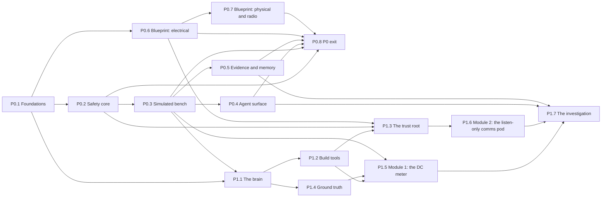

# Roadmap

The project is cut into numbered stages. Each stage ends in a **check-in**: a short list of things the owner can see working, and the decisions that are his to make. A stage is done when its check-in is closed.

There are no dates. Order comes from what each stage needs first. Live progress is on the [milestones page](https://github.com/rafe-walker/sawbones-labs/milestones) and in the [project](https://github.com/users/rafe-walker/projects/2), view "By phase".

- **P0** is everything that can be built and proved without hardware: software, firmware logic, and the blueprints, tested in simulation.
- **P1** is the Bench Core: seven rungs of real hardware, each proved by the rung below it.
- **Later phases** are named at the end and are not broken down yet.

## How the stages depend on each other

Read it as: an arrow means "has to be done first". Three things follow from the shape.

- The software stages (P0.2 to P0.5) and the blueprint stages (P0.6, P0.7) run side by side.
- The brain and the build tools (P1.1, P1.2) need only the checked parts list and the simulated bench, so real hardware can start well before P0 ends.
- The trust root (P1.3) waits for the safety core and the simulated circuits. Nothing that can energise a rail is built before its rules and its circuit are tested.

## Stages

| Stage | Goal | Check-in | Needs first |
| --- | --- | --- | --- |
| **P0.1 Foundations** | The repo builds and tests itself, real inverter data flows in read-only, and the parts list is checked part against part. | #151 | Nothing |
| **P0.2 Safety core** | The rules that decide whether anything may be energised, written and tested before any hardware exists. | #152 | P0.1 |
| **P0.3 Simulated bench** | A whole bench that runs with no hardware: the supervisor, the module protocol, the plugin host with sandboxed plugins, pretend modules, and firmware logic tested on an ordinary computer. | #153 | P0.2 |
| **P0.4 Agent surface** | Claude drives the simulated bench the same way it will drive the real one. | #154 | P0.3 |
| **P0.5 Evidence and memory** | Everything the bench does is recorded, checkable afterwards and remembered, with trust tiers the store computes itself and a first look that carries meaning. | #155 | P0.3 |
| **P0.6 Blueprint: electrical** | The wiring, designed and tested in software before any is laid out. | #156 | P0.1 |
| **P0.7 Blueprint: physical and radio** | The case, the cooling and the radio side, designed and tested in software. | #157 | P0.6 |
| **P0.8 P0 exit** | One pack of blueprints, and the design document rewritten to match it. | #158 | P0.2, P0.3, P0.4, P0.5, P0.6, P0.7 |
| **P1.1 The brain** | Rung 1. The Pi 5 on the bench from mains, running the P0 supervisor unchanged. | #159 | P0.1, P0.3 |
| **P1.2 Build tools** | Rung 2. The brain can flash, debug and watch every later board. | #160 | P1.1 |
| **P1.3 The trust root** | Rung 3. The interlock in hardware, proved on a lamp. | #161 | P1.2, P0.2, P0.6 |
| **P1.4 Ground truth** | Rung 4. A known voltage on the bench, checked against the meter on hand. | #162 | P1.1 |
| **P1.5 Module 1: the DC meter** | Rung 5. The first built instrument, isolated from the brain. | #163 | P1.2, P1.4, P0.3 |
| **P1.6 Module 2: the listen-only comms pod** | Rung 6. Reading the inverter directly, unable to transmit unless armed. | #164 | P1.3 |
| **P1.7 The investigation** | Rung 7. One real question about the EG4 answered end to end, read-only. The Bench Core's acceptance test. | #165 | P1.5, P1.6, P0.4, P0.5 |

## P0: prove it without hardware

### P0.1 Foundations

The repo builds and tests itself, real inverter data flows in read-only, and the parts list is checked part against part.

**Work:** #94, #95, #96, #97, #118, #167, #168

**Check-in (#151). You will see:**

- Checks run green on every change.
- A recording from your real Solar Assistant, replayed with the same result.
- The parts list with every open check closed or marked "measure the part in hand".

**You decide:**

- Order the parts for rungs 1 and 2 (the brain and the build tools)?

### P0.2 Safety core

The rules that decide whether anything may be energised, written and tested before any hardware exists.

**Work:** #101, #102, #105, #110, #111, #117, #169, #171, #172

**Check-in (#152). You will see:**

- The interlock rules as a table, with a test behind each one.
- Random runs that never find a rail on in a forbidden state.
- The ground map of the Bench Core, with what it found.
- The threat model, and the checklist the real hardware has to pass.
- A bus guard in simulation that passes only the exact frame you approved.
- The approval scale written down, with test keys for the trust root and your phone.

**You decide:**

- #137: do approvals follow the hazard class?

### P0.3 Simulated bench

A whole bench that runs with no hardware: the supervisor, the module protocol, the plugin host with sandboxed plugins, pretend modules, and firmware logic tested on an ordinary computer.

**Work:** #98, #99, #100, #114, #132, #173, #174, #175, #176, #177

**Check-in (#153). You will see:**

- One command starts the supervisor with simulated modules.
- A simulated module that lies, stalls or disappears is caught.
- The firmware core builds for the RP2350 in the checks.
- A decoder that is a register map, with no code.
- A plugin that crashes or misbehaves, caught by the host and reported by the agent.

**You decide:**

- Nothing to decide. A look is enough.

### P0.4 Agent surface

Claude drives the simulated bench the same way it will drive the real one.

**Work:** #103, #104, #112, #115

**Check-in (#154). You will see:**

- Claude on your Mac reads the simulated bench.
- A hazardous action is refused without the panel press.
- An experiment plan runs offline and reports back.
- All three connection modes shown: online, plan, recorder.

**You decide:**

- #6: use the MWS Rust kit?

### P0.5 Evidence and memory

Everything the bench does is recorded, checkable afterwards and remembered, with trust tiers the store computes itself and a first look that carries meaning.

**Work:** #106, #107, #108, #109, #113, #178, #179, #180

**Check-in (#155). You will see:**

- A recorded session opened in the viewer.
- An evidence bundle that verifies, and a tampered copy that fails.
- The score on the diagnosis benchmark with planted faults.
- The first-look card: status, health with definitions, blind spots, recently resolved.
- A decoder fix that rebuilds its readings and marks every fact built on the old ones stale.

**You decide:**

- #138: is the store a bare chain for now?

### P0.6 Blueprint: electrical

The wiring, designed and tested in software before any is laid out.

**Work:** #120, #121, #122, #123, #124, #134

**Check-in (#156). You will see:**

- One model file that every drawing and budget is generated from.
- Schematics that pass rule checks.
- Simulations of the rail limit, the heartbeat watchdog and the stop.
- Wiring drawings generated from the model.
- A register of predictions to hold the real build against.

**You decide:**

- Order the parts for rung 3 (the trust root)?

### P0.7 Blueprint: physical and radio

The case, the cooling and the radio side, designed and tested in software.

**Work:** #125, #126, #127, #128, #129, #130, #131, #133

**Check-in (#157). You will see:**

- Printed parts that pass fit, collision and slicer checks.
- A thermal answer for the heat spreader and the fan.
- A spectrum ledger with no clashes.
- Antenna, shielding and microphone-array results, each with how far the simulation can be trusted.

**You decide:**

- Print the first test pieces?

### P0.8 P0 exit

One pack of blueprints, and the design document rewritten to match it.

**Work:** #135, #116

**Check-in (#158). You will see:**

- The blueprint pack: schematics, wiring, printed parts, budgets and predictions.
- Design document v2.

**You decide:**

- Go for the trust-root build?
- #140: publish the outside review documents?

## P1: the Bench Core

### P1.1 The brain

Rung 1. The Pi 5 on the bench from mains, running the P0 supervisor unchanged.

**Work:** #142

**Check-in (#159). You will see:**

- It boots from the NVMe drive.
- It reports its own rails and temperatures.
- It power-cycles one hub port.
- Four hours of Solar Assistant recorded with no gaps.

**You decide:**

- Nothing to decide. A look is enough.

### P1.2 Build tools

Rung 2. The brain can flash, debug and watch every later board.

**Work:** #143

**Check-in (#160). You will see:**

- The brain flashes and debugs an RP2350 board.
- It captures and decodes a serial line.

**You decide:**

- Nothing to decide. A look is enough.

### P1.3 The trust root

Rung 3. The interlock in hardware, proved on a lamp.

**Work:** #144

**Check-in (#161). You will see:**

- The lamp stays off through boot, reset, brownout and a hung Pi.
- The stop works with the Pi powered off.
- A lost heartbeat drops the rail.
- An expired or reused approval is refused.
- Firmware cannot change without the jumper.

**You decide:**

- Sign off the acceptance checklist?
- #139: is the thrust stand the first real customer of the interlock?

### P1.4 Ground truth

Rung 4. A known voltage on the bench, checked against the meter on hand.

**Work:** #145

**Check-in (#162). You will see:**

- The reference measured against the meter, with a stated uncertainty.
- Those values stored as the first measured facts.

**You decide:**

- Nothing to decide. A look is enough.

### P1.5 Module 1: the DC meter

Rung 5. The first built instrument, isolated from the brain.

**Work:** #146

**Check-in (#163). You will see:**

- It agrees with the reference within a stated uncertainty.
- It notices a disconnected, stale or out-of-range input.
- A reflash drops it to unverified until it passes again.
- Measured behaviour set beside the P0 predictions.

**You decide:**

- Nothing to decide. A look is enough.

### P1.6 Module 2: the listen-only comms pod

Rung 6. Reading the inverter directly, unable to transmit unless armed.

**Work:** #147

**Check-in (#164). You will see:**

- It reads the EG4 directly, listen-only.
- Disarmed, it cannot drive the bus.
- Its numbers beside Solar Assistant's, with any difference explained.

**You decide:**

- Nothing to decide. A look is enough.

### P1.7 The investigation

Rung 7. One real question about the EG4 answered end to end, read-only. The Bench Core's acceptance test.

**Work:** #148

**Check-in (#165). You will see:**

- A named experiment with a hypothesis and what would prove it wrong.
- The recorded session and its evidence bundle.
- Facts in the store, each with its scope.
- A short report.

**You decide:**

- Is the Bench Core accepted?
- What comes first in P2?

## Later phases

Named, not broken down. They are laid out after the Bench Core is accepted (tracked in #1).

- Analog capture, in two bands
- The thrust stand
- The site port
- Senses: sound, vision, thermal, air
- Radio, receive only
- Portability: the battery, the case and cooling
- The vehicle
- Idea parked: reading aircraft transponders overhead (#12)

## Rules of the roadmap

- A stage closes at its check-in, not when the code merges.
- Work is handed out in small pieces, one crate or one check each, so it can stop at any point without loss.
- Nothing is ordered before the part-against-part check for that rung is done.
- A new stage or a changed order is recorded in [DECISIONS.md](DECISIONS.md).
