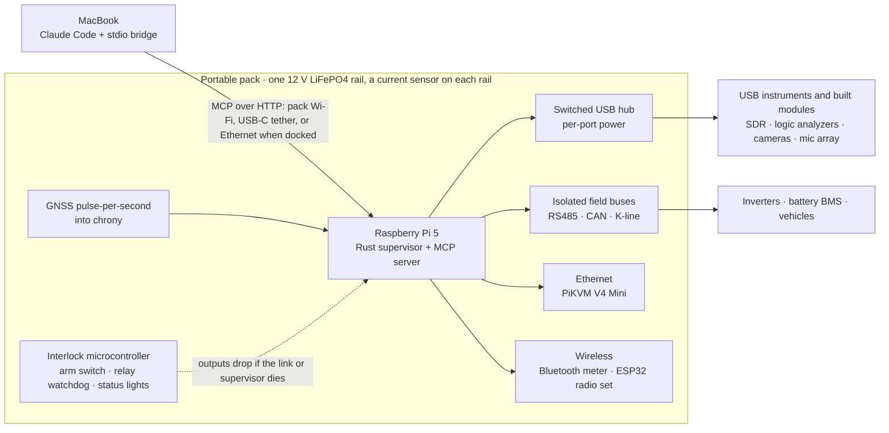

# Sawbones: agent-first Maker's bench and portable test bench

Project document

Working design document. Last synced 26 November 2026, rev 104. Joshua Bryan, with Claude.

> Status: design phase. Nothing here is built or bench-tested yet. Prices marked estimate or unverified have no checked page behind them. "You" in this document is the project owner; "I" is Claude, the agent the bench is designed for.

## Status after review round 1

Four outside reviews came in late on 25 November. The principles survived. The first build shrinks to a Bench Core, and a new phase, P0, comes before any hardware. The sections below this one predate the reviews and are being rewritten as a P0 task. Where they disagree with this section, this section wins.

The full point-by-point response, with every verdict and the checks behind it, is in the repo at [docs/reviews/review-round-1-response.md](reviews/review-round-1-response.md).

### What changed

| Area | Change |
| --- | --- |
| Connectivity | Three named modes: online, plan and recorder. A cloud model needs a link, so the pack joins the network the Mac is on. Its own access point is a last resort. Plan mode is the main field mode. |
| Authority | The arm switch is one input, not the system. Added: an emergency stop that works with the Pi off, a watchdog outside the Pi, outputs off on every kind of restart, a latched fault, and a trusted panel with a display and button for class 3 approvals. The five hazard classes stay. |
| The rail is the permission | Each hazard class gets a power rail limited by hardware. What the agent can do without asking is bounded by copper, not by policy. |
| Trust root | The interlock controller takes firmware only with a physical jumper fitted. |
| Reflashing | A reflash is a trust reset. The module drops to unverified until it passes the calibration cross-check again. |
| World text | Network names, device names, decoded packets, OCR and speech are typed as untrusted and can never raise a fact above unverified. |
| Module standard | A small spine beside USB-C: armed rail, calibration pair, sync. Nothing is frozen until three unlike modules exist. |
| Isolation | Every terminal declares its ground domain, and the supervisor refuses a connection plan that makes a loop. The Mac on its charger is on the map. |
| Parts | USB-C RP2350 boards in place of Picos. A USB 2 hub. Storage, cooler, clock battery, and a 5 A supply added. No meter is bought for P1. The PiKVMs stay on the fixed bench. Cooling is designed and simulated in P0: an aluminium heat spreader and a temperature-switched fan. Charging in peak heat is not a design driver, because the pack can cool down and charge indoors. |
| Measurement | "Self-test passed", not "calibrated". Each stream reports its own timing uncertainty. The 48 V bank is measured through an impedance-limited tap and a rated shunt. |
| Solar | The agent's part ends at the no-contact stages. It does not direct connector or string work. |
| Evidence | Results are ranked hypotheses with what would prove them wrong. A borrowed viewer, Rerun, in place of a home-built dashboard. |
| Store | Still a ground-up Rust store, starting as the bare hash chain and growing by need. Values can be erased without breaking the chain. |
| Positioning | Anthropic's Model Hardware Standard exists as a gated preview. This design is the physical and instrument-health layer beside it, not a rival platform. |

### Phases

**P0: everything that needs no hardware.** The brain's software running on the Mac against simulated modules, the firmware for the first boards, and the hardware itself designed, simulated and tested as files: one pack model from which budgets, schematics, wiring drawings, printed parts and the parts list are generated and checked on every change. P0 ends with a blueprint pack. A simulation result is never "measured", and every prediction is written down next to the P1 measurement that will check it.

**P1: the Bench Core. Approved on 26 November.** Mains-powered, on the bench, read-only.

| Rung | Build | Verified by |
| --- | --- | --- |
| 1 | The brain: Pi 5, cooler, clock battery, NVMe, proper supply, switched hub | Its own health telemetry |
| 2 | Build tools: debug probe and logic analyzer | The brain |
| 3 | Trust root: interlock controller, emergency stop, armed rail, panel, jumper. Proved on a lamp | The brain and the logic analyzer |
| 4 | Ground truth: one bought reference meter and the on-board reference | Each other |
| 5 | Module 1: DC meter | The reference |
| 6 | Module 2: isolated listen-only RS485 and RS232 pod | The logic analyzer and Solar Assistant |
| 7 | One real EG4 question answered end to end | Everything above |

The brain is first because every later rung is flashed, powered, timed and recorded by it. The parts are on a private Amazon list: 36 lines, about $729 before tax with quantities, of which about $110 is wire, boards and cables to skip if they are on hand. No meter is bought for this phase; the voltage reference module and the meter on hand cover low-voltage work. Analog capture, the thrust stand, the site port, senses, radio, portability and the vehicle follow in later phases.

## Concept and scope

The pack is a carry-case sensor body that Claude drives over Wi-Fi from the MacBook. Every instrument, and the pack's own internals, are exposed through one write-safe MCP server.

It does three jobs, in rising order of risk:

1. **Observe**: passive capture with nothing attached to the thing under test. RF, sound, video, thermal, air.
2. **Measure**: probes and bus taps attached to the thing under test. Multimeter, logic analyzer, OBD-II, RS485, CAN, BLE.
3. **Act**: outputs that change the world. Relay, programmable supply, bus writes, IR, firmware flashing. Always gated.

|  | Portable pack | Fixed Maker's bench |
| --- | --- | --- |
| Power | Internal battery, USB-C PD in | Mains or the house 48 V system |
| Link to Claude | The network the Mac is on, or a tether. Its own access point is a last resort | Wired Ethernet on the LAN |
| Instruments | Small, rugged, USB or wireless | Adds bench supply, scope, soldering, printer |
| MCP surface | Same server | Same server, more instruments registered |

The pack docks into the bench as its sensor core. Nothing is built twice.

Field problems it is sized for:

- An EG4 inverter drops load or a rack battery falls out of balance at a certain time of day.
- The truck throws an intermittent code or has a rattle that only shows at speed.
- Something is stepping on Wi-Fi, Starlink, Zigbee or a 433 MHz sensor.
- A circuit, pump or mini split draws more than it should, or a connection runs hot.
- A board on the bench will not boot and needs its rails, buses and firmware checked.

Out of scope for the first build: selling it, and anything that needs a cloud service to work in the field.

## Design principles

One rule drives every choice: anything a person could read off a screen or a knob, the agent reads as data, along with the health of the thing producing it.

1. **The agent is the primary operator.** No instrument goes in the pack if its only interface is an LCD or a closed phone app.
2. **Instruments are also patients.** Each device reports its own firmware version, supply rail, temperature, error counters and calibration state. Where firmware is open, the agent can rebuild and reflash it.
3. **Every reading carries provenance.** Instrument ID, range, units, raw and scaled value, calibration state, and a timestamp from one shared clock.
4. **Ground truth is on board.** A voltage reference, a known resistor, a tone source and a known RF signal let the agent self-test before it trusts a number.
5. **MWS for the write surface, a physical layer on top.** Every act tool meets MWS 0.9 (truthful results, targeting, concurrency, atomicity, retries). MWS says nothing about physical effects, so arming, previews and limits are this project's own layer, and a candidate annex for MWS.
6. **No internet required.** True for the pack, which records and runs a pre-sent plan alone. A cloud model still needs a link. See the status section.
7. **Borrow before building.** Proven open-source drivers get wrapped by a Rust supervisor, not rewritten.
8. **Open and reproducible.** Public repo, printable enclosure parts, a bill of materials with part numbers, and CI that builds firmware and runs simulated instruments.

## System architecture

A Pi-class brain in a weatherproof case runs one Rust supervisor. Instruments hang off a switched USB hub and isolated field buses on a 12 V battery rail, and the Mac reaches it over the pack's own Wi-Fi.

*Simplified redraw of the architecture diagram: one supervisor, four connection classes (USB, isolated field bus, Ethernet, wireless), one power rail.*

Every read and write passes through the supervisor, which is also the only thing that powers, identifies and reflashes instruments.

| Layer | Choice | Why | Cost |
| --- | --- | --- | --- |
| Brain | Raspberry Pi 5, 4 GB. The spare Yellow is the $0 fallback. | USB 3 for SDRs and cameras, one-cable [USB Ethernet](https://www.raspberrypi.com/news/usb-gadget-mode-in-raspberry-pi-os-ssh-over-usb/) to the Mac, mainline OS. | [$110](https://hwbusters.com/news/raspberry-pi-5-16gb-price-jumps-to-385-and-the-extra-8gb-now-costs-more-than-a-whole-8gb-board/) |
| USB | [Plugable USB3-HUB7BC](https://plugable.com/products/usb3-hub7bc), 7 ports, runs on 12 V | It is on the [uhubctl](https://github.com/mvp/uhubctl) list for per-port power switching, so the agent can power-cycle one hung instrument. Test every port on arrival. | $49.95 |
| Power | 12 V LiFePO4 rail, bucks to 5 V, a current sensor on each rail | A 25 to 45 W load for 4 hours needs 100 to 180 Wh before conversion losses and 120 to 210 Wh with them, more than a power bank holds. | About $100, unverified |
| Link | Pack is the Wi-Fi access point. USB-C tether as fallback, Ethernet when docked. | Works with no internet. A second radio stays free for sniffing. | $0 |
| Clock | GNSS module with a pulse-per-second line into chrony | Absolute time and position. Each stream reports its own timestamp uncertainty. | $29.95 |
| Eyes and hands | None in the pack. The PiKVMs stay on the fixed bench | Driven over its API. | $0 |
| Case | [Apache 3800](https://www.harborfreight.com/3800-weatherproof-protective-case-large-black-63927.html), IP65, printed PETG panel in six tiles | Cheap, sealed when shut, panel fits the 180 mm bed. | $39.99 |
| Interlock | Arm switch on the panel, relay watchdog, status light ring | Outputs drop if the link or the supervisor dies. | About $15 |

Three constraints from the MCP side:

- **Claude Code connects directly** over HTTP with a bearer token. The [desktop app's connectors](https://support.claude.com/en/articles/11175166-get-started-with-custom-connectors-using-remote-mcp.md) come from Anthropic's cloud and cannot see a LAN-only pack, so a small stdio bridge runs on the Mac.
- **Tool results are capped** at 25,000 tokens by default. Every tool returns a summary plus a link to the stored data, never raw samples.
- **The current MCP revision (2026-07-28) is stateless.** Live telemetry is pulled or subscribed, not pushed over a session.

Heat sets the operating rule. The PiKVM is rated to 50 C and PETG softens at 69 C, the dashboard temperature an [ASU study](https://news.asu.edu/20180516-discoveries-asu-study-hot-cars-can-hit-deadly-temperatures-within-one-hour) measured after an hour in sun. The pack runs lid-open in shade and never lives in a parked truck in summer. The supervisor reads its own temperatures and sheds load.

### Status display

The pack shows its state on the panel without a screen or the Mac. A strip of addressable LEDs, about $5 to $10, is driven by the interlock microcontroller and not by the Pi, so it still tells the truth when the Pi hangs.

| Light | Meaning |
| --- | --- |
| Power, hard-wired to the rail | The pack is on. Software cannot turn this off. |
| Recording, hard-wired to camera and mic power | Something is capturing. Software cannot hide this. |
| Brain | Booting, running, or hung (the heartbeat stopped). |
| Link | The Mac is connected and an agent session is open. |
| Armed, red | The panel switch is on and outputs can be energised. |
| One per hub port | Module healthy, self-test failed, or port powered off. |
| Battery bar | Charge level from the fuel gauge. |

The mic array's own 12-LED ring points toward the sound the agent is listening to. A small display showing the Wi-Fi name and a connect code is a phase-2 add.

## Module standard

A module is anything with a manifest. Only identity, a core RPC and the manifest are mandatory, so a store-bought meter and a home-made pod plug into the same system.

### How a module works, in plain terms

A module is one job in one box: a DC meter, a K-line reader, a thermal eye. Most are a $3 to $10 microcontroller board plus one sensor chip, in a printed tray that drops into the grid, with one USB-C cable to the hub.

Plugging one in goes like this:

1. **Power.** The hub turns on that one port and measures what the module draws.
2. **Who are you?** The module answers with its ID, model and the hash of the firmware it is running.
3. **Look up the datasheet.** The brain finds the manifest for that model in the knowledge store. Now it knows the channels, units, limits and risks.
4. **Prove you work.** The module runs its self-test. If it measures something, the calibration bus feeds it a known value and checks the answer.
5. **Appear.** The module shows up to Claude under the same few tools as everything else. No new tools, no restart.

When a module misbehaves, the agent works down a ladder: read its health and logs, run the self-test, power-cycle its port, rebuild the firmware from the repo and reflash it, and roll back if the new build fails its own self-test.

Three kinds of module use the same rules:

- **Built modules** run our shared Rust firmware core, so identity, health, self-test and update come for free. The builder writes only the sensor part and the manifest.
- **Bought devices** such as an SDR dongle or an OBD adapter cannot describe themselves. A manifest file on the brain describes them instead.
- **Wireless pods** talk by radio to a gateway module, which speaks for them.

Someone else can add a module without asking: print a tray in a standard size, use USB-C, start from the firmware core, write the manifest, and pass the public test suite in CI.

| Layer | Rule | Borrowed from |
| --- | --- | --- |
| 0. Mechanical, recommended | 42 mm grid in 1x1, 1x2 and 2x2 sizes. No part over 168 mm, so everything prints on a 180 mm bed. Label carries ID, a QR link to the manifest and a risk colour band. | Gridfinity, Framework expansion cards |
| 1. Electrical | Profile U: USB-C and 5 V from a per-port-switched hub. Profile G: everything else (I2C, RS485, CAN, K-line, radio pods) hangs off a gateway module. | USB gives hot-plug, power, enumeration and firmware update for free |
| 2. Identity, mandatory | A 128-bit UID, a model ID in `vendor.family.model` form and a manifest hash. Carried in USB descriptors, the core RPC, a small ID chip, or a host-side file for unmodified commercial gear. | [Raspberry Pi HAT+](https://pip-assets.raspberrypi.com/categories/1215-raspberry-pi-hat/documents/RP-008281-DS-1-hat-plus-specification.pdf): small ID on the board, rich description on the host |
| 3. Core RPC, mandatory for our firmware | identify, describe, health, selftest, time, config, log, update with rollback, reset, safe\_state | [DroneCAN](https://dronecan.github.io/Specification/6._Application_level_functions/) node services, carried over [postcard-rpc](https://raw.githubusercontent.com/jamesmunns/postcard-rpc/main/docs/overview.md) |
| 4. Host driver | One out-of-process driver per family: probe, open, describe, read, invoke, subscribe, health, close. A sim driver replays recorded sessions. | Kismet datasources, Viam modules |
| 5. Manifest, mandatory | The agent-readable datasheet: a [W3C Thing Description](https://www.w3.org/TR/wot-thing-description11/) style JSON document with our additions. | WoT already has `safe`, `idempotent`, `readOnly` and `unit` |

The manifest is the new contribution. No existing standard gives an agent all of this in one document:

- **Channels:** unit, range, accuracy, calibration date and reference, and how each timestamp was obtained.
- **Operations:** risk tier, preconditions, interlocks, what physically changes, and the safe state.
- **Limits:** absolute maximum ratings per terminal, isolation rating.
- **Firmware:** source repo, commit and image hash, so the agent knows exactly what is running and can rebuild it.
- **Failure modes:** symptom, likely causes, checks and remedy, written for an agent to act on.

### Conformance levels

| Level | Meaning | Example |
| --- | --- | --- |
| L0 Described | A host driver and a valid manifest held on the host. | RTL-SDR, OBD adapter, inverter over Modbus |
| L1 Identified | The module carries its own ID. Hot-plug resolves the manifest automatically. | A breakout with an ID chip |
| L2 Core | Implements the core services and passes the test suite. | A scatter pod |
| L3 Agent-maintainable | Update with rollback, a reproducible build whose attested hash matches what the module reports, a sim driver and a golden recording. | The reference pod and calibration bus |

### Two shape decisions

- **The MCP surface is a few fixed meta-tools**, not one tool per instrument function: list, describe, read, invoke, capture, query session. Tool-definition cost stays flat as modules are added, and it suits the stateless MCP revision.
- **Wireless pods sit behind a gateway module.** They are not first-class bus citizens, which keeps identity, time and safe-state in one place.

### Where Interlock fits

Three standards stack cleanly: MWS covers the write surface, Interlock covers physical effects enforced on the device, and this module standard covers description and lifecycle.

Interlock is the working name from the 24 and 25 November research; you confirmed that is the idea you meant. Its parts map directly onto fields above:

| Interlock idea | Where it lives here |
| --- | --- |
| Bounded leases that fail safe when the agent goes silent | `safe_state` plus the host-heartbeat watchdog in the core RPC |
| Idempotency keys with on-device retry de-duplication | Core RPC invoke path, reported in the MWS write result |
| Declared interlocks and preconditions | Manifest operation fields, enforced in firmware |
| Human approval the chip verifies itself | The panel arm switch, wired to the module rather than to the host |
| Signed receipts with a sensor reading taken after the action | The pack measures its own outputs, so every act can prove its effect |

That makes the bench the natural first Interlock reference rig and its hardware-in-the-loop benchmark.

### Approvals matched to danger

You approve hazards, not readings. Most of what the agent does needs no prompt at all.

| Class | Examples | Approval |
| --- | --- | --- |
| 0. Observe | Passive capture, reading a meter, a camera frame, a store lookup | None |
| 1. Touch-safe and reversible | Reading over a bus, scanning or connecting to an owned device, a bench output under the touch-safe limit with a low power cap, speech, lights, flashing our own modules, which roll back | None. Logged. |
| 2. Bounded effect on your gear | Changing a non-protective setting, transmitting on an owned channel inside legal power, a short actuator test with the engine off, flashing a device that has a recovery path | The arm switch. On means yes for the session, with no per-action prompts. |
| 3. Hazardous or hard to undo | Battery protection limits and charge voltages, inverter output settings, anything above the touch-safe limit, firmware with no recovery path, tests on a running engine | Your yes each time. The agent states what will happen and the stop condition first. |
| 4. Not offered | Mains or string switching, emission-control changes, jamming | Never by the agent |

The line between classes 2 and 3 rests on a real standard. IEC 62368-1's lowest electrical class, ES1, [tops out](https://psu.deltaww.com/de/industry-know-how/what-is-the-difference-between-selv-pelv-and-es1-in-ac-dc-power-supplies) at 60 V DC or 30 V AC rms. Below that and a modest power cap, the worst case is a blown fuse.

One exception is written into the manifests: the 48 V battery bank is touch-safe by voltage but not by energy. Anything that closes a contactor or could short it is class 3.

The store's "measured" tier needs no approval either. It is granted from the evidence. You are asked to attest only what cannot be measured.

### Governance

Short specs spread. Spec text under CC BY 4.0, hardware under CERN-OHL-P, code under Apache-2.0, USB IDs through pid.codes. Every MUST traces to a test that runs in GitHub Actions against simulated modules.

## Equipment knowledge store

The store is a signed hash chain of small typed facts plus a folder of hashed files, with a search index that can be rebuilt at any time. The bench and the pack each write their own chain and copy the other's, so a sync is provably complete and nothing is silently overwritten.

It holds everything known about your gear: the EG4 manual by hash, the register map as typed signals, baud rates and pinouts with the evidence behind them, quirks, calibration records, the Tacoma's profile, healthy-baseline recordings, and every module's manifest. Step 3 of plugging in a module is a lookup here.

### What the two repos give us

I had both repos read end to end. You have since chosen a ground-up Rust rebuild on IsoKron's principles, with no duty to stay byte-compatible with kronicle-lite. So the table below is a list of ideas to carry over, not formats to match. Most of the old platform stays behind.

| Need | Existing piece | Plan |
| --- | --- | --- |
| Hash-chained log, signed checkpoints | kronicle-lite `docs/FORMAT.md` | Rebuild in Rust and keep the ideas: public genesis, signed checkpoints, hashes that cover type, actor and time. An export that kronicle-lite's own `verify-chain` can verify is optional, later. |
| "Did what I relied on change?" | kronicle-lite orient: cursor, drift banner, retraction list | Port the semantics. |
| "May I act on this?" | kronicle-lite's `can_act`, `inspect_only`, `never_act` labels | Keep, with evidence redefined as "measured on the bench". |
| Check at the moment of action | IsoKron Atlas preflight (ADR-0060) | Before a hardware write the agent names the facts it relies on. The store answers allow, reject or re-orient. |
| Typed facts | IsoKron `atlas_claim_projection` | Borrow the shape: subject, predicate, value, unit, scope, evidence, trust tier. |
| Typed edges | IsoKron RelationLink, 21 link types | Cut to about 10. |
| Sync | IsoKron `sextant-spool`: a framed, hash-chained log where the receiver checks each batch against its last hash | Port the idea to Rust. |
| Register CSV into facts | IsoKron Recognizer DSL: a deterministic parser that records where each field came from | Port as a Rust trait. |
| Everything else in IsoKron | 17-entity ceiling machinery, firewall, row security, compile pipeline | Skip. |

Four things in the archive differ from the notes I had:

- The IsoKron event chain was SHA-256. BLAKE3 was used only for block content hashes.
- HyPE embeddings were specified but never built.
- The chain's genesis came from a secret in Supabase Vault, so the old chain cannot be verified now. kronicle-lite uses a public genesis, which is the right design.
- Nothing from the archived private repo is copied into a public one without a scrub.

### Shape

| Layer | Choice | What it proves |
| --- | --- | --- |
| Chain | One per node, our own event format, Ed25519-signed checkpoints | History is untampered, and which node wrote each entry. |
| Files | A folder addressed by BLAKE3 hash, fetched with [bao](https://docs.rs/crate/bao-tree/latest) verified streaming | Every chunk is checked on arrival. A transfer resumes, and the copy is bit-identical. |
| Index | SQLite full-text search plus small vectors | Nothing. It is a cache rebuilt from the chain and the files. |
| Sync | Pull when in Wi-Fi range. Compare signed heads, fetch missing entries, then missing files. | The same signed head means the same history. |
| Conflicts | Two different values for one fact show as "contested" | Never last-writer-wins. You or the agent settle it with a measurement. |
| Compression | zstd, with hashes taken over the uncompressed bytes | Recompressing never changes a hash. |
| MCP surface | About eight tools: search, get at version, changes since cursor, propose fact, attach evidence, supersede, verify, preflight | Writes carry an expected version and an idempotency key, as MWS and the stateless MCP revision both require. |

Eight kinds of thing, derived from IsoKron's 17:

| Kind | Example |
| --- | --- |
| Device | The EG4 3000EHV-48 as a model, and your unit with its serial and firmware |
| Interface | Its RS232 port: connector, pinout, electrical limits |
| Protocol | The Modbus register map at one revision |
| Signal | One register: address, width, scale, unit, valid range |
| Document | The manual, a schematic, a set of wiring photos |
| Procedure | "Capture a baseline", "enter comms mode" |
| Quirk | "Ignores back-to-back requests without a 50 ms gap" |
| Measurement | A calibration record or a baseline recording |

Every fact carries a trust tier: measured, operator-attested, documented, agent-inferred or unverified. Only the first two can ever justify a write to hardware. That rule is the join between the store and Interlock.

### Rules that keep it honest

- **No floating-point numbers in anything hashed.** Scale factors go in as decimal strings. This removes the main way Rust and TypeScript could disagree on a hash.
- **The chain holds hashes and small facts only.** No bulk bytes, no secrets, no raw telemetry. A sensor pack would flood the change list in seconds.
- **Order by chain position, not by clock.** A Pi without a clock battery produces wrong times.
- **Start with one device end to end.** The EG4 inverter: manual, register map, one measured baseline, one quirk, with the agent reading from it on day one. IsoKron's own history shows the risk: 104 of its 343 foundation migrations were vocabulary churn.
- **Plain search first.** Exact keyed lookup, then full-text, then vectors. Published tests favour this: a [file-and-search agent](https://letta.com/blog/benchmarking-ai-agent-memory) beat a graph memory 74.0% to 68.5%, and plain retrieval beat GraphRAG on an [e-manual set](https://arxiv.org/abs/2603.29875).

### Riffs

- **Protocol knowledge the agent can run.** A protocol is stored as a parser description and tested in CI against captured traffic held by hash. A [2025 study](https://langsechq.gitlab.io/spw25/papers/anantharaman-llm-parser-generation.pdf) found model-written parsers accept malformed input, so the capture tests are not optional.
- **Facts that know how to re-check themselves.** "Baud rate 9600" links to the procedure that measures it. Confidence decays until re-measured, which gives the bench an idle-time to-do list.
- **Corrections keyed to a manual's hash.** Vendor manuals stay private. What you worked out is published against the PDF's hash, so anyone holding the same file can use it without redistribution.
- **Radio summaries that reconcile.** A reading sent over a slow link carries a short hash of its full record, so the summary and the later full sync are provably the same reading.
- **Shareable device profiles.** A profile exports as a bundle that anyone can verify offline.

Hash-pinned memory for agents looks like open ground. Five 2026 papers on agent memory with provenance were read and none uses content hashes. One [shows](https://arxiv.org/abs/2610.07309) that text-only checks cannot detect a superseded memory while metadata checks can.

Not settled: an embedding model for the Pi (throughput figures are nearly undocumented, so vectors may be built on the Mac and shipped), PDF tables and pinout figures, and what to do the day a photo with a password in it gets ingested into a log that cannot forget.

## The store from the agent's seat

This is the store I would want to drive. One call tells me what changed and what I can no longer trust. Answers arrive as small cards with citations I can check. Anything visual comes back as a picture I read with my own eyes. Every write is one atomic batch I can preview. And the store will not let me promote my own guesses to truth.

It is a ground-up Rust build on four IsoKron principles: a typed graph, every change on a hash chain, staleness detected instead of assumed, and evidence outranking assertion.

### One session, start to finish

1. **Orient.** I hand over my cursor from last time. I get back, in a few hundred tokens: what changed, which facts I relied on that have since been superseded, what is contested, and my open cases with the next step I had planned.
2. **Brief.** I ask for a card on inverter 2 with a token budget. It packs identity, how to talk to it, known quirks, last baselines, open issues, where it sits on the site map, and pointers to dig deeper. Each line shows its trust tier and age.
3. **Find.** Exact lookups first: "register 0x0124 on this unit's firmware". Full-text and similarity search come second. An empty answer says what was searched and what was not.
4. **Look.** I ask for the manual page that a fact cites, cropped to the cited box. I read the table myself instead of trusting an old extraction.
5. **Measure.** The pack takes the reading. The recording lands in the store as a measurement with its instrument, conditions and hash.
6. **Commit.** I send one batch: three facts with their evidence, two links, an update to the case. I run it dry first and see what would change and what would go stale.
7. **Preflight.** Before any write to hardware I name the facts I am relying on. The store answers allow, reject or re-orient.
8. **Hand off.** I leave a note for the next session: what I would check next and why.

### Pictures and maps

A frontier model reads images well, so the store treats them as first-class evidence and as a way to answer.

- **Any region of any image can be a citation.** A fact can point at a blob hash, a page and a box. Asking for that citation returns the crop at the size I ask for.
- **Layouts.** A layout is a flat canvas with coordinates that things are placed on. The property site map from your drone orthomosaic is one. So are the shed, a panel array with its string map, the battery rack, a connector face with its pinout, the truck's harness, and a circuit board.
- **Readings drape over layouts.** A geotagged noise walk or thermal pass becomes an overlay on the site map or the array.
- **A rendered map comes with its list.** The picture carries numbered markers, and the same reply lists each marker's entity, position and value. Distances and counts are computed by the store and written into that list, because models count and judge distance poorly on maps.
- **I can point back.** My pixel aim is only approximate, so the store offers numbered candidate regions and I answer with a number. The chosen region is kept as an annotation, so the next time that wiring photo is shown it arrives already labelled.
- **Evidence bundles are one image.** Aligned panels on a shared time axis, with the healthy baseline in grey.

### Writing

- **One tool, one batch, all or nothing.** A commit is a list of typed operations: put an entity, assert a fact, link two things, attach a file or a region, supersede, retract, note.
- **Later operations can refer to earlier ones** in the same batch, so "create the device, then attach these facts to it" is one call.
- **Each operation carries the version it expects**, and the batch carries an idempotency key. A retry after a dropped connection can never apply twice.
- **Dry run returns a preview:** what would change, what conflicts, and which derived facts would be invalidated, plus a plan token. Applying by token commits exactly what I reviewed.
- **The result is truthful per operation**, in the MWS shape.
- **Nothing is deleted.** Facts are superseded or retracted, and two conflicting values stand side by side as contested.

### Trust is earned by evidence, and the store enforces it

| Tier | What it takes | Who can grant it |
| --- | --- | --- |
| Measured | A measurement record from an instrument that passed its self-test | The store, from the evidence |
| Operator-attested | Your confirmation, asked through the client or the panel | You |
| Documented | The value found in the document's own text layer at the cited box, or confirmed by you | The store, from the citation |
| Agent-inferred | Anything I concluded, including any value I read off a page image | Me |
| Unverified | Imported with no evidence | Anyone |

I cannot write "measured" by saying so. This is the guard against the failure in the Jeep story, where a borrowed scale factor was trusted without a check.

### Case files

A case is the working memory of a diagnosis: the symptom, my candidate causes with a probability on each, what each predicts for the next test, the results, and the verdict. Open cases come up at orient. Predictions are optional and kept for expensive tests. One controlled study found that forcing a predict-then-test loop on every step cost seven to eight times the tokens without beating a simpler approach.

Every session also leaves a friction note: what in the tools was slow, missing or confusing.

### Getting knowledge in

- **Structured files compile.** A register-map CSV goes through a deterministic parser that records the source line of every field.
- **Documents are read, then checked.** The store rasterises pages and hands me the images. I propose typed rows, which enter as agent-inferred. The store validates types, units and ranges and checks each value against the page's text layer; a match earns "documented". Table reads fail silently, with a lost decimal point or a flipped sign, so nothing I read is trusted on my say-so. Wiring read from a schematic image is the weakest case and always gets a continuity check.
- **Originals are kept by hash**, with a private flag. Vendor manuals never leave the store.

### The tools

| Tool | Does | Returns |
| --- | --- | --- |
| `orient` | Changes since my cursor | Short delta, stale-reliance list, open cases |
| `brief` | Briefing card for an entity or a case | A card sized to the token budget I give |
| `find` | Exact key, full-text or similarity | Citations: id, version, short hash, one line |
| `get` | Fetch by id and version, many at once | Bodies or links |
| `render` | Map, layout, page crop, annotated photo, plot | An image plus the same content as a list |
| `commit` | Atomic batch write, with dry run | Per-operation outcome and new versions |
| `ingest` | Turn a file into proposed facts | Page images and proposals for me to review |
| `preflight` | Check the facts I am about to act on | Allow, reject or re-orient |
| `query` | Read-only SQL over the index | A capped table |

### Under the hood

| Part | Choice |
| --- | --- |
| Truth | A per-node append-only chain of small events in segment files, with a public genesis and signed checkpoints. A folder of content-addressed files beside it. |
| Index | SQLite, rebuildable from the truth: entities, facts and links, full-text search, a spatial index for layouts, and vectors. |
| Atomicity | The chain append is the commit point. One commit is one chain group and one index transaction; after a crash the index catches up from the chain. |
| Big rasters | Tile pyramids, so a crop of the site map is cheap. |
| Size | An NVMe drive on the bench Yellow holds everything. The pack carries all facts and a working set of files, and fetches the rest on demand. |

### Checked against what Claude clients really do

The design above was checked against current documentation and bug reports. Nothing here has been tested on your own clients yet.

| Fact | What the store does about it |
| --- | --- |
| An image costs about width/28 times height/28 tokens. Newer Claude models take up to 2,576 px on the long edge, about 4,784 tokens; older ones 1,568 px. ([vision docs](https://platform.claude.com/docs/en/build-with-claude/vision)) | Default renders are about 1344 x 896, roughly 1,500 tokens. A detail tier goes to 2576 x 1449. A full manual page renders near 197 DPI. |
| Claude Code warns at 10,000 tokens per tool result and caps at 25,000, images included. ([docs](https://code.claude.com/docs/en/mcp)) | One image per render call. Replies stay under 10,000 tokens unless I ask for more. |
| Zoom works. A crop-from-original tool raised chart reading from 29% to 73% in Anthropic's own [test](https://platform.claude.com/cookbook/multimodal-crop-tool). | Zoom is a first-class render option, cropped from the original at up to 400 DPI. |
| Pixel pointing is approximate, and grid overlays did not reliably help. ([docs](https://platform.claude.com/docs/en/build-with-claude/vision-coordinates)) | Numbered pins tied to store ids. I answer with ids. |
| Two open bug reports: Claude Code dropped an image when a structured block rode with it, and ignored resource links. Fix status unknown. | Render returns one image plus a plain-text legend. Nothing depends on resource links. |
| The current MCP revision is stateless and has deprecated sampling. | The store cannot borrow my model. It prepares page images, I read them, and I commit. Retries lean on the idempotency key. |
| Reading PDFs natively is an upload feature, not an MCP one. | The store rasterises pages itself. |
| Confirmation prompts work only in interactive sessions. | Your attestation can also come through the panel switch or by voice. |

Named building blocks, all current on crates.io: `rusqlite` with full-text and R\*Tree for the index, `tiny-skia` and `resvg` for drawing, `pdfium-render` for pages, `pmtiles` for the site map, `geo` and `rstar` for layouts. Vectors start as brute force and get an index only when size demands it.

## Software tools and Rust on the Pi

The agent gets Wireshark and Kali-class tools as a short list of typed, fenced capabilities, never as a shell. This project's own code for the Pi is Rust where that makes sense. A proven tool that exists only in C or Python is used as it is, as a sandboxed child process. A port happens only with a reason and a test to check it against.

### Tools for the agent

Two findings set the design.

- **Raw tool output is unaffordable.** In one 2026 study, raw `tshark` JSON for a capture of a few megabytes averaged about 22 million tokens. Compact summaries answered 99.3% of forensic questions, against 51% for truncated text. So every tool returns a summary card and a handle to the stored data.
- **The common pattern is unsafe.** Kali's own [mcp-kali-server](https://raw.githubusercontent.com/Wh0am123/MCP-Kali-Server/main/README.md) and most "pentest MCP" servers are thin bridges to a shell, with no allow-list of targets or arguments. One widely used server has a critical command-injection flaw (CVE-2025-35028). In a research demo, text planted in a web page steered an AI test agent to a reverse shell in about 20 seconds.

That second finding is the reason for four rules:

1. **Typed wrappers, not a run-command tool.** Arguments are allow-listed. Nothing is passed through a shell.
2. **An owned-assets list.** Your devices, networks, vehicles and serial numbers live in the knowledge store. Active tools can only touch what is on it. Everything else is observe-only.
3. **Kernel fences.** Only the capture helper holds raw-network rights. Each tool runs in its own network namespace pinned to one allowed interface, with memory and CPU caps so a scan cannot starve the sensors.
4. **What tools observe is data, never instructions.** Network names, device names, banners and strings inside firmware arrive as typed, length-capped fields with their source marked.

Widened on 25 November at your direction: transmitting and active security testing are in scope for equipment and networks on the owned-assets list, on your property. Two things stay out. Jamming and other deliberate disruption of radio are barred by federal law whoever owns the land, because signals do not stop at a fence. And I do not write exploit or malware code for any purpose; established assessment tools pointed at your own gear cover what you asked for.

### Security testing of your own gear

Your question about the batteries is a fair one. Reuters reported in May 2025, citing two unnamed people, that undocumented communication devices including cellular radios had been found in some inverters and batteries from several Chinese suppliers. No manufacturers were named and [pv magazine](https://www.pv-magazine.com/2025/05/14/hidden-devices-found-in-chinese-made-inverters-in-the-us-reports-reuters/) could not verify it. The pack can answer the question for your own units by measurement.

| Step | Question | How | Transmits |
| --- | --- | --- | --- |
| 1 | Is it radiating at all? | SDR and ESP32 waterfalls across 2.4 GHz, sub-GHz and cellular uplink bands with the battery powered and working, compared against powered off | No |
| 2 | What does it advertise? | Bluetooth and Wi-Fi survey: names, services, and whether it offers its own access point | No |
| 3 | Who does it talk to? | If it joins a network, move it to an isolated test access point and record every lookup and destination, and whether the traffic is encrypted | Your own network only |
| 4 | Who can talk to it? | Connect over Bluetooth as a stranger would. Does it ask for pairing or a PIN? Which settings can be read or changed without one? | Yes, owned device only |
| 5 | What is inside? | Open one unit and photograph the boards. Match every radio module and antenna against the documentation. | No |
| 6 | What firmware does it run, and who can change it? | Read the version over the wired port and check whether updates are authenticated | No |

Steps 1 and 5 are the direct checks for a hidden radio. Step 4 is the likelier real-world risk on budget batteries: a Bluetooth link that lets anyone in range change settings. Each answer lands in the store as a measured fact, and the usual fix is cheap: unplug the wireless module and use the wired port.

Two cautions. Anything in step 4 that writes to a battery is done on one unit with its breaker open, not on the live bank. Tests that work by breaking a link are run cabled or inside a shielded box, never over the air.

One gap to know about: the reference SDR stops near 1.75 GHz. It sees the low and middle cellular uplink bands but not those at 1.9 GHz and above. Step 5 covers that until a wider receiver is on the bench.

| First capabilities | Tool underneath | Tier |
| --- | --- | --- |
| Capture and summarise on any interface | dumpcap and tshark | Observe |
| Query a stored capture by filter or SQL | tshark, DuckDB over Parquet | Observe |
| "What is on my network" inventory, with a diff against last time | nmap, arp-scan | Measure, owned subnets only |
| Decode a Modbus, CAN or serial capture | tshark dissectors, sigrok | Observe |
| Wi-Fi, Bluetooth and Zigbee survey | Kismet, btmon, rtl\_433 | Observe, receive only |
| Identify and unpack a firmware file | binwalk v3, which is already Rust, and unblob | Measure |
| Read the flash of a device you own | flashrom, esptool, probe-rs | Measure |
| Logic capture with protocol decode | sigrok-cli | Measure |

The first, second and sixth are the ones used to build and check the rest, so they come first.

Heavy reverse engineering such as Ghidra runs on the Mac, on exactly the bytes the Pi captured, proven by hash. Bulk number-crunching uses a sandbox where the agent runs a short script next to the data and gets back only the answer; Anthropic [reports](https://www.anthropic.com/engineering/code-execution-with-mcp) up to 98.7% fewer tokens that way.

Three things only a pack with both instruments and software can do:

- **Wire and packet on one clock.** A Modbus error in the capture lines up with a voltage glitch on the logic trace of the same wires.
- **Firmware history.** When a device you own updates, the pack re-reads it, diffs it against the stored version, and records what changed.
- **Protocol learning loop.** For an undocumented frame the agent proposes a layout, predicts the next frame, captures again to confirm, and promotes the confirmed map into the store.

### Should all the Pi code be Rust?

All the code we write, yes. All the code that runs there, no, not in the first two phases.

What you heard about is real: Ubuntu now ships Rust versions of its core utilities and sudo, the Linux kernel dropped Rust's "experimental" label in December 2025, Git is making Rust mandatory, and binwalk was rewritten in Rust. All of these replaced one component at a time.

Ubuntu is also the warning. An outside [audit](https://discourse.ubuntu.com/t/an-update-on-rust-coreutils/80773) found 113 issues and 44 CVEs in the Rust utilities, and a date bug silently broke automatic updates in one release. Those were logic bugs, not memory bugs. A rewrite removes one class of fault and can add another.

| Benefit for this project | Evidence |
| --- | --- |
| Memory safety where hostile input arrives off the air | rtl\_433 has a 2026 [overflow](https://www.vulncheck.com/advisories/rtl-433-through-25.12-stack-based-buffer-overflow-via-proflame-2-decoder) triggerable by a crafted radio signal. Wireshark went from 7 reported flaws in 2025 to 121 in 2026. |
| One definition of every message, shared by firmware and host | The same `no_std` crates compile for the ESP32, the Pico and the Pi. |
| One static binary per program, cross-built in free CI | No interpreter or package tree to keep in step on the pack. |
| Small and steady on a 4 GB Pi | Only one self-reported figure found, 12 to 18 MB for a daemon. No rigorous benchmark exists. |
| The compiler checks agent-written code | Mixed. Rust tops one multi-language benchmark at 58% and trails Python badly on another. A compiler catches type errors, not wrong logic. |

The first row cuts both ways: it argues for sandboxing the C tools at least as much as for rewriting them.

In the two large agent-built Rust projects on record, quality followed the test oracle and the CI, not the language. Anthropic's [C compiler](https://www.anthropic.com/engineering/building-c-compiler) worked because every change was checked against an outside reference.

| Component | Verdict |
| --- | --- |
| Knowledge store, Interlock, module manifest and conformance tools | Write fresh in Rust. Nothing suitable exists and correctness is the point. |
| K-line, EG4 and JBD drivers, LoRa telemetry, Bluetooth meter bridge, fusion and trigger engine | Write fresh in Rust. No crate exists for most. |
| Modbus, CAN, USB, flashing, recording, storage, search | Use mature Rust crates. |
| rtl\_433, Kismet, readsb, sigrok, tshark, nmap, mic localisation, speech | Wrap as child processes. Port later, one at a time. |
| Operating system | Raspberry Pi OS Lite with a read-only root and A/B updates that roll back. No all-Rust system exists for the Pi 5, and monitor-mode Wi-Fi needs a patched C driver regardless. |

Five rules:

1. Our code is Rust where it makes sense.
2. Outside tools run as sandboxed child processes behind one typed driver protocol.
3. No port without a differential test on recorded captures against the original.
4. GPL code never links into the Apache-2.0 daemon. Several useful Rust crates are GPL, so the process boundary is needed anyway.
5. Every parser of outside input is fuzzed in CI.

## Core payload

Each sense below has a chosen pick with an open data path. These are the bought picks from the first research round. The build-it-ourselves section replaces the vehicle adapter, mic array, bench meter and most radios with home-built modules, and the budget section is the current list. Three of your starting assumptions changed in research: the inverter protocol, the 360 camera's value, and which SDR to buy.

| Sense | Pick | Price | How the agent reads it |
| --- | --- | --- | --- |
| Sub-GHz, ADS-B, HF | 2 x [RTL-SDR Blog V3](https://www.rtl-sdr.com/buy-rtl-sdr-dvb-t-dongles/), one with the dipole kit, plus an FM band-stop filter | About $97 to $107 | rtl\_433 JSON, readsb `aircraft.json` |
| Wi-Fi 2.4, 5 and 6 GHz | mt7921au USB adapter, in-kernel driver | About $25 to $35 | [Kismet](https://kismetwireless.net/docs/api) REST |
| Zigbee and Thread | [nRF52840 Dongle](https://www.digikey.com/en/product-highlight/n/nordic-semi/nrf52840-usb-dongle) | $11.02 | Kismet source or Wireshark extcap |
| Bluetooth LE | The Pi's own radio | $0 | Kismet HCI source |
| Spectrum and RF ground truth | tinySA Ultra+ ZS407, to 7.3 GHz | About $178, a December 2025 price | [USB serial console](https://tinysa.org/wiki/pmwiki.php?n=Main.USBInterface): `scan`, `selftest`, `vbat` |
| Sound direction and voice | [ReSpeaker XVF3800](https://www.seeedstudio.com/ReSpeaker-XVF3800-USB-Mic-Array-p-6488.html) 4-mic array | $54.90 | Direction of arrival and beam energy as numbers |
| Sound spectrum | [ICS-43434](https://www.adafruit.com/product/6049) wideband I2S mic | $8.95 | ALSA capture, spectrograms rendered on the pack |
| Aimed vision | [Camera Module 3](https://www.adafruit.com/product/5657) on a [pan-tilt kit](https://www.adafruit.com/product/1967) with a laser | About $54 | libcamera stills and crops |
| Thermal | [MLX90640](https://www.sparkfun.com/sparkfun-ir-array-breakout-110-degree-fov-mlx90640-qwiic.html) 32 x 24 array | $39.95 | I2C, per-pixel temperatures |
| Vehicle | [WiCAN Pro](https://www.meatpi.com/products/wican-pro) | $89 plus $8 shipping | MQTT and HTTP API, open ESP32-S3 host firmware |
| Inverters | 2 x [Waveshare USB to RS232/485 (B)](https://www.waveshare.com/product/iot-communication/usb-to-rs232-485-b.htm), isolated, one per inverter | $18.99 each | Modbus RTU through tokio-modbus |
| Battery racks | Same adapters, plus RJ45 and RJ11 breakouts | Breakouts unpriced | `jbd-up` driver, about 1 s refresh on a direct pack connection |
| Bench meter | [OWON XDM1041](https://specpicks.com/product/B0CYYZXWY9) | $139 | Serial at 115200; `*IDN?` returns model, serial and firmware |
| DC bus | 2 x [INA228](https://www.sparkfun.com/sparkfun-current-sensor-ina228-qwiic.html), 85 V rated, behind an I2C isolator | $14.95 each | I2C: volts, amps, energy |
| Logic | fx2lafw 8-channel analyzer and a Pico running sigrok-pico | About $15 to $23, estimated | sigrok-cli decode |

### What changed

- **Inverters speak Modbus, not Voltronic.** Solar Assistant's [help page](https://origin.solar-assistant.io/help/inverters/eg4/3000-EHV-48/rs232) says to select "Sumry" for the 3000EHV-48, and an open [register map](https://raw.githubusercontent.com/HotNoob/PythonProtocolGateway/main/protocols/eg4/eg4_3000ehv_v1.holding_registry_map.csv) exists. You confirmed the Sumry setting on 25 November. The Voltronic tools do not apply. EG4's manuals do not confirm baud rate or pinout, so the first job is a listen-only capture.
- **A 360 camera is the weakest value in the list.** Only [Ricoh Theta](https://www.adorama.com/used-ricoh-theta-x-360-degree-225-touchscreen-spherical-camera/p/vdcirctx) has an open Linux path, a Pi handles its 4K stream poorly, and a 2026 [benchmark](https://arxiv.org/abs/2603.16179) found models read raw panoramas badly. An aimed camera puts more pixels on a small part. A used Theta for stills fits phase 2, served as perspective crops.
- **The RTL-SDR V4 is discontinued** as of May 2026, and marketplace "V4" listings are often fakes. The V3 is the safe buy.
- **HackRF and KrakenSDR are out.** HackRF Pro is [$400](https://greatscottgadgets.com/hackrf/pro). KrakenSDR is $499 or more and stops at 1766 MHz. A GPS-tagged signal-strength walk with a directional antenna does the one-person job.
- **The mic array hears to 16 kHz only.** It locates sounds; the wideband mic characterises them. The array's LED ring and 5 W amplifier double as the pack's status light and voice.
- **The battery driver is new work.** The only open implementation of the UP16S protocol is a [Python driver](https://github.com/mr-manuel/venus-os_dbus-serialbattery/blob/master/dbus-serialbattery/bms/lltjbd_up16s.py). It exposes 16 cell voltages, balance state, cycle count, state of health and 47 fault and alarm bits.
- **The bench meter is bench-only.** A buyer review calls the XDM1041 CAT I/II. It never touches the battery bank or mains.
- **Two more of your devices have local paths.** The EG4 mini split is reported as a Tuya device with an existing [Rust bridge](https://github.com/tfoote000/eg4heatpumptuyatomqtt). The Delta Pro works over local BLE with [ha-ef-ble](https://github.com/rabits/ha-ef-ble).

## Older vehicles beyond OBD-II

On the Tacoma the OBD port is the slow channel. The pack's edge is fast signals tied to a cylinder, on one clock, compared against the truck's own healthy baseline.

The 2003 Tacoma has no CAN bus. Forum evidence puts it on K-line (ISO 9141-2, pin 7), where a Bluetooth dongle manages about 6 requests a second. That is enough for codes and slow trends, not for catching a misfire. Confirm the protocol on first connection.

### What the Jeep story teaches

The video you saw is almost certainly Muhammad Zulali's 1994 Cherokee, published 10 November 2026. He used a $15 Arduino bridge to the pre-OBD-II plug, with Claude Code doing protocol and diagnosis, and released it as [xj-scanner](https://github.com/MZULALI/xj-scanner).

- **Why it worked:** a three-wire serial bridge, an open definitions file to start from, and an agent that could log a drive, read it and change one thing.
- **The one documented error:** a fuel-trim scale borrowed from another tool produced a wrong "22% rich" call, per [The Autopian](https://www.theautopian.com/i-guess-ai-can-fix-a-jeep-cherokee-xj-now/). Blind changes then made NOx worse at about $100 a retest.
- **The controversy:** the fix changed the fuel map. Critics say that masks a mechanical fault and runs into emissions-tampering law.

So every derived value in this project carries where its definition came from and gets a second-sensor cross-check. ECU writes stay out of the default tool set, and the project does not help defeat emission controls.

### Phase-1 vehicle kit, about $150

| Probe | Cost | What it answers |
| --- | --- | --- |
| Cranking capture: battery voltage at 1 to 10 kHz plus audio | About $5 | Battery and starter health, cranking speed, even or uneven compression. Separates slow crank, no fuel and no spark in one capture. |
| Ignition pickup on one plug lead | $5 DIY to [$45](https://www.aeswave.com/collections/lab-scopes-accessories-ignition) | Tells every other waveform which cylinder it is looking at. Engine speed at event rate, independent of K-line. |
| Low-amp current clamp | $60 to [$80](https://www.aeswave.com/collections/lab-scopes-accessories-current-probes) | Coil ramps, injector opening, fuel pump wear, parasitic drain. |
| Manifold vacuum sensor | About $20, estimated | Valve sealing per cylinder, restricted exhaust. |
| Fuel pressure sensor | $20 to $50, estimated | Prime, running pressure, drop under load, leak-down. |
| Back-probe pins | $10 to $42 | Throttle sensor glitches, O2 switching straight from the wire. |
| Contact mic | About $10 | Injector tick per cylinder, bearing and valvetrain noise. |

These need a fast capture channel. The [Hantek 6022BE](https://sigrok.org/wiki/Hantek_6022BE) is the only cheap scope with confirmed open tooling; it is 8-bit and limited to 5 V, so attenuators are mandatory. Its price is unverified.

### Making it dead easy and AI-first

1. **Simulate first.** A demo vehicle ships in the repo. The agent and the user rehearse before a wire goes near the truck.
2. **Vehicle profile.** One file holds year, engine and your manual and 4WD conversion, with the codes that are swap artefacts. The agent stops chasing those.
3. **Verify every connection.** Meter each pin before connecting; wire colour is not evidence. The agent checks lead routing by camera before any engine-running test.
4. **Engine fingerprint.** One 5-second fuel-disabled crank, captured on every channel and resampled to crank angle, becomes a one-page health card. Re-run monthly and the agent reports drift per cylinder before a code sets.
5. **Camera-read blink codes.** The agent names two pins to bridge, watches the dash lamp and decodes the flashes. Zero wiring, and it works on pre-1996 Toyotas and Hondas.
6. **Narrated test drives.** You say "there, that shudder". Speech timestamps on the shared clock mark exactly the seconds to analyse. No screen while driving.
7. **Diagnosis as a wager.** Before an expensive or risky test the agent writes its candidate faults and what each predicts, and the tool layer scores it. This stays optional: a controlled study found that forcing it on every step costs far more tokens for no gain.
8. **Wasted-spark compression check.** The 5VZ-FE fires plugs in pairs, so comparing the two firing voltages per coil gives a relative compression indicator from outside the engine, rear bank included.
9. **Legacy front-end module, phase 2.** One board with a single-wire serial line (selectable pull-up and inversion), a lamp watcher and a switched jumper covers GM ALDL, Chrysler SCI, VW KW1281 and blink codes. After that each make is a definitions file.
10. **Baselines shared by engine, not by car.** Owners publish fingerprints and confirmed-fault captures for an engine family. This is the open counterpart of the vendor waveform libraries.

Smog prep matters less for you than for other users: Arizona tests only in the Phoenix and Tucson areas under [A.R.S. 49-541](https://www.azleg.gov/ars/49/00541.htm).

Not yet sourced: 5VZ-FE fault patterns, the under-hood diagnostic connector on a 2003, and Toyota's service-manual pricing. The research budget ran out on this lane, so it needs a second pass and a factory manual.

## Fusing data streams

Every stream lands on one clock in one session file. A trigger pins the same window across all of them, and the agent gets a small evidence bundle instead of raw data.

1. **Clock.** The host clock is disciplined by chrony from the GNSS pulse. Raw device timestamps are kept alongside measured offsets and corrected afterwards, the [Lab Streaming Layer](https://labstreaminglayer.readthedocs.io/info/time_synchronization.html) practice.
2. **Sync event.** A light flash, a click and an electrical edge fire together at session start and end. Every sensor sees one of them, which measures each stream's real latency.
3. **Store.** Rotating [MCAP](https://mcap.dev/spec) segments in a ring buffer. MCAP is MIT-licensed, has a maintained Rust crate, stamps every message in nanoseconds and recovers after power loss. Radio IQ goes in SigMF sidecar files.
4. **Triggers.** Declarative rules: threshold, rate of change, band energy, a bus frame, a sequence within a window. Also the event button, a spoken "mark", and the agent itself. A trigger pins the seconds before and after across all streams.
5. **Evidence bundle.** Index, then statistics with cross-stream lags, then one aligned multi-panel image, then zoomed re-renders, then raw slices by link. A Google [study](https://arxiv.org/abs/2410.02637) found plots beat pasted numbers for multimodal models at up to 90% lower cost.
6. **Replay.** The same session files drive simulated drivers in CI. Published sessions pass a privacy scrub first.

Stream timing is not equal, and the manifest says so per channel:

| Stream | Timing quality |
| --- | --- |
| CAN frames | Microsecond kernel timestamps |
| USB audio | About 1 ms after delay compensation |
| Camera frames | Stamped at end of frame, so tens of milliseconds |
| K-line and Modbus polls | Only a request window is known |
| Wireless pods | Unmeasured; no sourced figure yet |

### What fusion answers

| Symptom | Streams on one timeline | How the agent reads it |
| --- | --- | --- |
| Slow or no start | Cranking audio, battery sag, starter current, ignition pickup, fuel pressure | One capture separates battery or starter, no spark, no fuel and low compression. |
| Knock or ping | Audio near the knock band gated by ignition, engine load, timing advance from OBD | Audible knock with no timing pull points at the knock sensor circuit. Timing pull with no knock points at a noisy sensor or a rattle. |
| Misfire | OBD misfire counter, coil current per coil, exhaust pulse, runner temperature | Three sensors agreeing name the cylinder. Disagreement names a bad sensor or scale. |
| Vibration since the 4WD swap | Accelerometer spectrum against GNSS speed | A peak at driveshaft speed suggests imbalance. Twice that suggests U-joint angle. |
| Inverter drops load mid-afternoon | Inverter warning bits, per-cell voltages, bus current, thermal array, shed temperature, HF noise floor | Whichever stream moves first is the lead. |
| Wi-Fi or Zigbee drops | Spectrum sweeps against charger and inverter state | Noise that tracks a power state names the source. |

For engines, traces are resampled to crank angle so each cylinder overlays the others. A healthy baseline is drawn in grey behind every panel.

No existing framework does a cross-sensor black box for a hobby pack; the ones surveyed are single-domain. No published test shows how well current models read spectrograms or scope traces, so the first experiment is to measure that before the bundle format is frozen.

## More senses and outputs

The best additions are cheap probes, a few actuators that let the pack test itself, and software that turns data it already has into diagnoses. Ranked by diagnostic value per dollar. Phase here means priority; the budget section decides what the first $1,000 covers.

| Add | Phase | Price | What it gives the agent |
| --- | --- | --- | --- |
| Calibration bus: voltage reference, 0.1% resistors, relay board | 1 | About $25 to $35, estimated | Checks the meter and every ADC against known values at boot. No existing instrument server cross-verifies instruments. |
| Self-test stimuli: chirp, IR flash, heater resistor, 50-ohm terminator | 1 | About $10 | Proves a sensor works before a null reading is trusted. |
| Scatter pods: [ESP32-C3](https://www.adafruit.com/product/5337) with accelerometer and temperature probes | 1 | About $20 each | Clip-on vibration and temperature where the pack cannot reach. Same boards as your home sensors. |
| Thermocouple amp and IR spot thermometer | 1 | $14.95 and $18.95 | Exhaust runners, burners, lugs, bearings. The IR spot follows the laser. |
| GNSS receiver | 1 | $29.95 | Location on every reading and the shared clock. |
| Pickup coil into a spare audio input | 1 | About $5 | A "current stethoscope": injector pulses, ignition, relay clicks and inverter ripple as spectrograms, no circuit broken. |
| Event button | 1 | About $5 | You press it when "it just made the noise". Every log aligns to that instant. |
| Near-field probes | 1 | About $5 | Finds which box is radiating the noise. |
| IR transceiver | 1 | $5.95 | Puts the mini split into test modes. |
| BME688 gas sensor | 1 | $19.95 | Smell classes such as burnt insulation or raw fuel. A relative sniffer, never a safety alarm. |
| Load cell and bridge ADC | 1 | About $10 | Weighs a propane cylinder for fill level. |
| TDS probe | 1 | $11.80 | Hauled-water quality trend. |
| Topdon TC001 thermal camera | 2 | About $199 | 256 x 192 radiometric images, with a Rust reader. |
| Ultrasonic mic ([AudioMoth USB](https://groupgets.com/products/audiomoth-usb-microphone)) | 2 | $79.99, sold out | Gas and air leaks, arcing and corona above 20 kHz. |
| AC power-quality sampler: small transformer and current clamp into an audio ADC | 2 | Unpriced | Distortion, sag and frequency of inverter output. No cheap open product exists. |
| Used Ricoh Theta | 2 | $142 to $424 | Whole-scene stills, served as crops. |
| Reference solar cell pod | 2 | Unpriced | Separates low sun from an underperforming string. |
| UV light ring and dye | 2 | About $10 | Slow oil, coolant and refrigerant leaks show on camera. |
| CO2 and spectral sensors | 2 | $49.95 and $18.95 | Combustion venting and flame colour on propane appliances. |

### Free, because it is software

- **Black-box mode.** The pack stays on site with ring buffers running. A trigger saves the seconds before and after across every sensor. This is the answer to intermittent faults.
- **Agent-directed A/B tests.** The agent asks you to switch one device off and on while it sweeps, then reports the difference. It is the most useful RF workflow for inverter and charger noise.
- **Pack walk.** You move one lead from battery to battery. The agent builds a per-pack report and flags the odd one and any firmware mismatch.
- **Three-way disagreement.** Inverter voltage against BMS voltage against the pack's own tap. The gap under load is cable drop; the gap at rest is calibration error.
- **Cell resistance from normal load steps.** A pump start gives per-cell voltage drop over current. A weakening cell shows long before a protection trip.
- **The comms bus as a sensor.** Bias, amplitude, termination and error rate on RS485 and CAN. Many "battery comms lost" faults are wiring.
- **Protocol fingerprinting.** Listen-only auto-baud and signature matching, so the pack names what is on a wire before anyone tells it.
- **Golden signatures.** Recordings of your own gear when healthy, for the agent to diff against later.
- **Radio census and baseline.** Every BLE battery, inverter and tracker in range at a new site, plus a per-site noise fingerprint. If every band drops at once, suspect the antenna.
- **A fixed sentinel.** The spare Yellow and one SDR logging at home tell the pack whether the noise was there before it arrived.

## Build it ourselves

Building from hobby parts cuts the like-for-like hardware bill by about a third and puts a real multimeter function into phase 1 for about $60. Standing rule from here on: every line gets a "can we build it cheaper and better" check before a "buy".

### The multimeter

Phase 1 gets two meters that cover each other, for less than half the $139 bench meter.

| Part | Cost | What it does |
| --- | --- | --- |
| ZOYI ZT-300AB or Aneng AN9002 handheld | $23 to $28 on AliExpress | Hand probing: volts, ohms, continuity, AC. Bluetooth, about 2.6 readings a second, [protocol fully documented](https://github.com/ludwich66/Bluetooth-DMM/wiki/Protocol-all-Variants), and a [Rust client](https://github.com/depau/bluetooth-dmm-rust) already exists. |
| Built DC meter module: INA228 on a Pico | About $11 to $19 | Volts, amps, power, energy and charge up to 85 V, continuously, on the shared clock, with our firmware. |
| OWON CM2100B clamp, optional | $38 to $45 on AliExpress | AC and DC current without breaking a circuit. Same open Bluetooth protocol family as OWON's meters. |

Where a built meter beats a bought one: several channels sampled at the same instant, every sample timestamped for fusion, self-checked against the calibration bus at boot, and firmware the agent can read and rebuild. A bench meter is one channel built for a person watching a display.

Where it does not: a cheap Bluetooth meter only mirrors its display, so you turn the dial and the agent reads. Counts drop from 55,000 to 6,000. Printed CAT ratings on these meters are not credible; [teardowns](https://lygte-info.dk/review/DMMOwon%20B41T%20UK.html) of sibling models found missing surge protection. They stay off mains and string voltage.

A full auto-ranging multimeter from scratch is false economy; the one serious open attempt took years. The honest phase-2 build is a focused, isolated 60 V DC volts-and-ohms module modelled on an existing [open design](https://github.com/MartinD-CZ/STM32F1-open-source-multimeter). The XDM1041 also shows on AliExpress from about $85 to $90, variant unconfirmed, which would make it a cheaper phase-2 buy.

### Radio, and what the ESP32 unlock really is

The RF share of the first plan was $78, not hundreds. The $400 and $499 radios were the ones I rejected. One RTL-SDR at about $40 stays because it is the only cheap part that hears everything from 500 kHz to 1.7 GHz as raw signal: unknown sensors, aircraft, and the harmonic combs an inverter throws off. Chips with a built-in modem hear only what that modem understands.

The unlock you heard about is ESP-SDR, public around 1 October 2026, with two independent finds just before it. An undocumented debug path in Espressif's radio test library dumps raw I/Q samples.

| Fact | Detail |
| --- | --- |
| Chips | Most of the family, including C3, C5, C6 and S3 |
| Bands | 2.2 to 2.7 GHz. The C5 adds 4.8 to 6.0 GHz. |
| Capture | Short snapshots on most chips. Continuous only on C6, C61, S3 and S31. |
| Transmit | Official firmware is receive-only. Community transmit forks exist and stay out of this project. |
| Rust | No port. Flash the prebuilt firmware and write the host client in Rust. |
| Use here | A $5 waterfall of the 2.4 GHz band on a C6 and of 5.8 GHz on a C5: who is using Wi-Fi, Zigbee and Bluetooth spectrum, and when. |
| Not for | 433 and 915 MHz sensors, LoRa, or inverter noise. All of that is below its range. |

Ground-up radio set, about $85 to $115 against $266 to $336 for the bought array:

| Module | Cost | Job |
| --- | --- | --- |
| RTL-SDR Blog V3 | $35 to $40 | Wideband raw receiver |
| 3 x ESP32-C6 | $3 to $6 each, unverified | 2.4 GHz waterfall, Wi-Fi per channel, Zigbee and Thread sniffing |
| 2 x ESP32-C5 | $4.93 each | 5 GHz Wi-Fi and waterfall, drone Remote ID |
| CC1101 | About $3, unverified | Sub-GHz sensor decoding on a chip |
| SX1262 board | $6 to $20, unverified | LoRa, which also carries the remote link |
| Home-made probes, loop and antennas | About $10 | Finding which box radiates |

For your inverter noise the cheapest useful kit is the RTL-SDR in direct sampling with a home-made coax probe, plus a wire loop into an audio input. Inverter switching sits at 18 to 60 kHz with harmonics up through shortwave. A basic tinySA at about $49 replaces the $178 model for this job.

### Building versus buying, both ways

Yes, both the mic array and the radio modules can run our own firmware, in Rust wherever the chip support is ready.

|  | Upsides of building | Downsides of building |
| --- | --- | --- |
| Mic array | Raw channels at full bandwidth, where the bought array stops at 16 kHz. Our geometry, so a wider array for better direction finding. Samples stamped on the shared clock. More mics for less money. | No built-in echo cancelling or beamforming chip; direction finding runs on the Pi and costs CPU. Cheap mics vary, so the array needs a matching and calibration step. Wind and port sealing are on us. Rust USB audio for many channels is unproven, so the first build may lean on an existing C library. |
| Radio modules | Several chips listen at once, one per band or channel, where one SDR sees one slice at a time. Decoding happens on the chip, so the Pi stays free. Low power, a few dollars each, expendable in the field. The same boards double as scatter pods. | A modem chip hears only what its modem understands. Sub-GHz decoding on a chip gets about half the range of an SDR, by its author's account. No calibrated power readings. The ESP32 raw-capture trick rides an undocumented path Espressif could close. Nearly every chip can transmit, so our firmware keeps it off until the arm switch is on. Rust support for the sniffing features is still marked unstable. |

The rule that falls out: build the listeners, and keep one bought SDR as the reference that can see anything.

### Everything else

| Module | Verdict | Cost | Note |
| --- | --- | --- | --- |
| Vehicle K-line and CAN pod | Build | $12 to $18, against $97 | Open firmware exists for [K-line](https://github.com/iwanders/OBD9141). No Rust K-line crate exists, so ours would be new. No Toyota example found; your truck is the test. |
| Solar comms pod | Build, and keep one bought isolated adapter as the reference | $8 to $15 each | Isolation is mandatory on battery links. |
| Mic array | Build | $15 to $25, against $55 | A Pico [library](https://github.com/denisgav/microphone-array-library-for-pico) already captures seven mics in step. Raw wideband channels suit the agent better than the voice-processed array. |
| Switched hub | Buy the hub, build a per-port switch and current-sense sidecar | $50 plus about $12 | A USB 3 hub from scratch is false economy. |
| GNSS | Buy a cheap clone | About $5, against $30 | Marketplace "u-blox" boards are mostly fakes. |
| Battery | Buy a LiFePO4 pack, build the converter, gauge and shutdown module | About $75, against $100 | A pack from loose cells is false economy. |
| Small sensors | Cheap clones, plus one or two genuine parts as references | About $25 for ten | Fake temperature and pressure chips are documented. The module self-test reads the chip ID and catches them. |
| Brain, thermal, cameras | Buy | Unchanged | Off-brand boards lost their price edge in 2026. |
| Custom boards | Hand-wire first | OSH Park, $5 per square inch for three | Orders from China carried 35% to 43% duty in recent reports. |

Three more cheap builds earn a place: an $18 PicoPD Pro board that turns any USB-C charger into a supply the agent sets, an $8 to $15 component tester running open firmware, and a Pico logic analyzer with 21 channels.

Worth watching: `oxrok`, a Rust port of the sigrok instrument stack with a built-in MCP server, first published in October 2026. Its own README calls it mostly untested on hardware.

## Remote mode

Yes to both: readings can travel from the far corner of the property to the bench Yellow, and the pack can speak results aloud. Your home Wi-Fi does not cover the lot today, so there are three ways to reach Claude from out there.

The cheapest is the one you suggested: carry the MacBook and run a phone hotspot. The pack and the Mac talk directly, and the hotspot is the Mac's path to Claude. It costs nothing and gives full MCP, but it needs usable cell data where you are standing.

The second is a LoRa pair at about $44 to $55 for both ends, which you moved to phase 2 on 25 November. One board on the Yellow and one on the pack is all it takes. The longest line on your lot is roughly 250 m, LoRa is a kilometre-class radio, and the link has 40 to 60 dB to spare at that distance even at low power. No repeaters and no mesh are needed.

The third, in phase 2, is one outdoor directional Wi-Fi access point at the bench end, which would carry full MCP across the lot.

| Tier | Link | What Claude can do |
| --- | --- | --- |
| 0 | USB-C or Ethernet, docked | Everything, plus firmware and bulk sync |
| 1 | Wi-Fi: pack to MacBook, or pack to an outdoor access point on the home network | Full MCP: all tools, images, audio, live store sync |
| 2 | Meshtastic private channel on a short-range fast preset | Receive readings at 1 to 10 a second, request a reading, run a pre-approved test plan, trigger speech. Read-only. |
| 2b | Same, long-range preset, 1 to 5 km | About one reading every 1 to 3 seconds |
| 3 | Recording on the pack, always on underneath | Nothing live. On return, the bench checks every radio summary against the full record. |
| 4 | No link | The pack runs its loaded plan, speaks results and records for later. |

MCP itself does not run over LoRa. A [Meshtastic packet](https://meshtastic.org/docs/overview/mesh-algo/) carries about 230 bytes, and an MCP tool list is kilobytes. The agent talks MCP to the bench, and the bench talks a compact signed format to the pack.

A reading fits in 35 bytes: sequence numbers, an 8-byte hash of the full record in the pack's store, time, channel, unit, value, uncertainty and an 8-byte authentication code. On the fast preset it is on air for about 60 ms.

### What will not work over LoRa

- Anything streaming or large: audio, radio captures, video, thermal streams, firmware.
- Actuation. Only read requests and speech are allowed over the radio.
- Verified data in real time. Radio readings are "reported, unverified" until the full records sync and the hashes match.

### Hardware

| Item | Cost | Note |
| --- | --- | --- |
| 2 x [Heltec WiFi LoRa 32 V4](https://heltec.org/project/wifi-lora-32-v4/) | $21.90 to $27.50 each | USB modules at both ends. Each can be reflashed for other LoRa stacks later. |
| Cables and a case-mount antenna | About $15 to $20, unverified |  |
| Amplifier board and small speaker | About $11, unverified | Driven by the Pi. |
| Outdoor directional access point | Unpriced | Phase 2. Needs a price check. |

On the bench side the Yellow has only two USB 2.0 ports, so the radio attaches by USB. A Meshtastic node accepts one client at a time, so the project's own bench daemon owns it: it verifies and de-duplicates messages, writes them to the knowledge store, publishes them to Home Assistant, and exposes them to Claude.

Licence note: Meshtastic's own [Rust crate](https://docs.rs/crate/meshtastic/latest) is GPL-3.0. It runs as a separate driver process and is not linked into the Apache-2.0 daemon, which the out-of-process driver design already allows.

One integration trap: a LoRa transmitter at full power a few centimetres from an SDR antenna can exceed the dongle's damage level. The link has 40 to 60 dB to spare at 250 m, so it runs at low power with separated antennas, and SDR capture pauses during each transmit.

### Voice

The Pi speaks offline through a subprocess: espeak-ng is instant and robotic, and Piper is natural at under a second per sentence. Common phrases are pre-rendered with numbers slotted in. Distinct tones mark good, bad and done, because tones carry in wind when speech does not.

Over the radio the agent sends a tiny "say" command: a phrase number plus the values. Voice input goes the other way as text, transcribed on the pack.

### The idea that makes remote work good

Send the plan ahead, not the conversation. While on Wi-Fi the agent compiles a signed, bounded field test plan: measure this, if below that ask the person to shade the panel, measure again, compare. The pack runs it offline and speaks the prompts. You become the agent's hands, and the radio carries only step numbers and results.

Every few minutes the pack also sends a beacon holding a short hash of its chain head. That gives the bench a tamper-evident commitment to everything recorded so far, even if nothing else got through.

## Roadmap: testing a failing solar panel

This is on the roadmap in all three phases. The first four stages need no electrical contact and find most faults, and phase 1 covers them with no extra hardware. Only the last stage opens connectors, on one panel, after isolation is confirmed.

One finding first: a 7 kW array peaking near 5 kW is probably normal, not a failed panel. At a 65 C cell temperature output is already about 0.86 of nameplate, and irradiance, dust and wiring take the rest. Ageing since 2022 accounts for only 2% to 4%; [NREL's fleet study](https://nrel.gov/docs/fy22osti/81314.pdf) puts the hottest climate zone at 0.88% a year. Two limits of your own system must be ruled out before blaming a panel: the array is throttled whenever the batteries are full, and each EG4 unit [accepts](https://eg4electronics.com/wp-content/uploads/2024/05/EG4-3000EHV-48-Spec-Sheet.pdf) at most 5,000 W and 18 A of PV.

Your two inverters are the best free instrument you own. Each has one tracker, so they are two independently metered strings that should match.

| Stage | What happens | Hazard | Instrument | A bad sign |
| --- | --- | --- | --- | --- |
| 0 | Desk check from telemetry | None | Solar Assistant data, a clear-sky model, satellite irradiance | One string 10 to 13 V low (a lost third of a panel), a current deficit, notches at the same time each day |
| 1 | Walk-round and photos | None | Pack camera | Burn marks, browned cells, melted or mismatched connectors, chewed cable |
| 2 | Thermal scan under load | None | Thermal array within 1 m of the panel back | A cell more than 10 K hot, a warm one-third strip, a hot junction box or connector |
| 3 | Shade test | None | An opaque cover, 1 Hz inverter data, spoken prompts | Covering a panel changes nothing, or current collapses (uncover at once) |
| 4 | String comparison at the combiner | Hazardous DC area | A rated DC clamp on insulated cable only | A string at 0 A, or one string low |
| 5 | Decide |  |  | Wiring, fuse and connector faults stop here |
| 6 | Isolate the one suspect panel | Hazardous DC until both connectors are open | Work for a qualified person under their own isolation procedure. The agent records and does not direct. A clamp reading near zero is an arc check, never proof that voltage is absent |  |
| 7 | Test the isolated panel | Low voltage | Bluetooth meter now, PV test module later | Voltage at two-thirds of the label, steps in the curve, a soft knee |

### Hard limits

- No home-built or USB-tethered meter ever touches string voltage. Your strings are likely 150 to 450 V DC.
- No connector is opened under load.
- The agent refuses to guide stage 7 until it has seen the stage 6 evidence.
- This procedure was assembled from practice notes, not a fetched safety standard. A qualified solar electrician should review it before the agent uses it.

What you told me on 25 November: there are three separate solar systems and several arrays. The 7 kW array has about five panels per string at 35 to 40 V each, so those strings sit near 175 to 200 V open circuit. Label photos come next. The two inverters are probably one V1 and one V2, so their register maps may differ; the store records which unit and firmware each fact applies to.

One thing to check on the EcoFlow array: EcoFlow [lists](https://www.ecoflow.com/us/blog/ecoflow-delta-pro-faq-everything-you-need-to-know) the Delta Pro's solar input as 11 to 150 V, 15 A and 1,600 W maximum. Six 35 to 40 V panels in one series string would be 210 to 240 V, over that limit. Either the wiring is series-parallel or the panel voltage is lower than remembered. Worth a look at the labels before anything else.

### By phase

| Phase | What the pack can do |
| --- | --- |
| 1 | Stages 0 to 3 in full: string ratio monitor, morning open-circuit trend, clear-sky comparison with [pvlib-rust](https://docs.rs/crate/pvlib-rust/latest), guided photos, thermal scan, shade test with voice prompts. Stage 7 voltage check with the Bluetooth meter. About $30 of add-ons: two temperature probes, a home-made reference cell, a shade cover, connector tools. |
| 2 | An open PV test module: a battery-powered, wireless, single-panel curve tracer with a reference cell, about $80 to $115 in parts, estimated. Its defining feature is refusal logic: it will not close above 60 V and must survive 600 V on its input. Not approved as specified after review round 1: it needs a full safety design first. A rated Bluetooth DC clamp at the combiner. |
| 3 | Permanent per-string current pods, a soiling-ratio pair, night-time diode checks. |

The tracer builds on [IV Swinger 2](https://github.com/csatt/IV_Swinger), an open design claimed at about $50. Its software is GPL v3, which matters for an Apache-2.0 repo. The bought alternatives are an Elejoy tester at [$89](https://shopsolarkits.com/products/elejoy-1600w-mppt-solar-panel-tester-multimeter) and the FLIR PV48 at [$189.99](https://www.transcat.com/flir-pv48-solar-panel-i-v-curve-tracer), neither with a stated data link.

### Diagnosis with nobody touching a wire

- **Full batteries as a free daily voltage test.** Whenever the bank is full the array floats near open circuit. Logged against temperature, a one-third-panel step shows months before lost energy does.
- **Twin-string alarms.** Each inverter's string is the other's reference. A drift in their ratio is the trigger.
- **Load on demand for the thermal scan.** Hot spots only show with current flowing. The agent asks for a big load, confirms from telemetry that the array is working, then scans.
- **Shadow wand.** A paddle on a pole shades one section at a time while the agent watches string voltage and calls "next".
- **Arc sniffing.** Loose DC connections radiate broadband noise. Walk the array with the SDR logging noise against position.

## Hardware on hand

Everything already owned gets a job. Only the PinePower supplies are dead ends for the agent, because they expose no data.

| Item | Job in this project | Limits found |
| --- | --- | --- |
| Spare [Home Assistant Yellow](https://github.com/NabuCasa/yellow) | Fixed-bench hub and 802.15.4 listener. Fallback pack brain at $0. | Two USB 2.0 ports and no USB 3, even with a CM5. Discontinued. Raspberry Pi OS runs only through a [community device tree](https://community.home-assistant.io/t/pi-os-instead-of-ha-os-on-yellow/473695/10). |
| In-service Yellow | Stays the solar host running deadzone. | The pack must not fight it or Solar Assistant for the inverter ports. |
| 3 x [PiKVM V4 Mini](https://docs.pikvm.org/v4/) | Eyes and hands on anything with HDMI and USB. One in the pack, one on the bench, one spare. | No USB host ports. Rated to 50 C. Read-only Arch OS, so the brain drives it over its [API](https://docs.pikvm.org/api/). |
| Bambu A1 mini | Case panels, module trays, sensor pods, arm parts. | 180 mm bed means tiled panels. PETG only; Bambu [rates ASA, ABS and PC](https://wiki.bambulab.com/en/general/filament-guide-material-table) as not recommended on it. |
| Pinecil | An instrument, not just a tool: tip temperature, setpoint, watts, handle temperature and last movement over [BLE](https://ralim.github.io/IronOS/Bluetooth). | V2 only, IronOS 2.21 or later. Which revision you own is unconfirmed. |
| PinePower desktop and V2 | Plain power. | [No documented data interface](https://pine64.org/documentation/PinePower/_full/). A $15 INA228 on the output gives the agent the numbers. |
| MacBook Pro M3 | Claude client, local speech-to-text, heavy analysis. | 16 GB memory caps local models. |
| DJI Mavic 4 Pro | Known Remote ID emitter for testing the RF array. | Test signal only. |

### PiKVM off-label uses

The PiKVM API already gives screen capture to 1920 x 1200, typed keys and mouse, a virtual USB drive, and built-in OCR on snapshots. Corrected after review: the V4 Mini has no USB host port and no documented user GPIO header, so it cannot drive servos or USB switches. Its ATX port does give two isolated outputs, meant to press a PC's power and reset buttons, and two inputs meant to read its LEDs. On the fixed bench those can press a button on a device under test or trigger an external relay.

- **Run vendor-only software by proxy.** A junk Windows mini PC runs the tools that have no open protocol (Toyota Techstream, the JBD battery PC tool, inverter updaters). The PiKVM is the agent's eyes and hands on it. This reuses HNAO work directly.
- **Read instruments that only have a screen.** An HDMI microscope or HDMI-out scope becomes a camera feed with OCR.
- **Be a USB stick on command.** Instruments that update from a flash drive can be handed firmware without anyone walking over. Gated as a write.
- **Press real buttons.** kvmd's [servo driver](https://docs.pikvm.org/gpio/) does this on PiKVM models with GPIO. The V4 Mini is not one, so a servo finger would run from a bench module instead.
- **Debug a board under test.** Boot screens, BIOS and serial-over-USB gadget for single-board computers on the bench.

## Fixed Maker's bench

The bench can watch, measure and coach for about $50 now. A breadboard the agent rewires is phase 2, and an arm is phase 3 with a narrower job than soldering.

| Idea | When | Cost | What the research says |
| --- | --- | --- | --- |
| Soldering camera | Now | From $25 | [Camera Module 3](https://raspberrypi.com/products/camera-module-3) has autofocus and 12 MP. Add a second oblique view later. |
| Iron telemetry | Now | $0 | Tip temperature dips and power spikes mark each joint, so the agent gets dwell time per joint without vision. Needs a Pinecil V2. |
| Instrumented breadboard, DIY | Now | About $30 | Current-sensing power rails plus multiplexed ADC taps on the rows. The agent keeps a netlist you speak aloud and checks it by measurement. |
| Appliance power signature | Now | $21 | [Shelly Plug US Gen4](https://us.shelly.com/products/shelly-plug-us-gen4-white) meters a device under repair over a local API. |
| Hands-free voice | Now | $0 | Push-to-talk into local Whisper on the Mac. |
| Laser "agent finger" | Phase 2 | About $15 | Two servos and a laser dot let the agent point at the part it means. |
| Fiducial mat and angled light ring | Phase 2 | About $20 | Printed tags map camera pixels to millimetres. Lighting from several angles shows joint shape. |
| [Jumperless V5](https://www.crowdsupply.com/architeuthis-flux/jumperless-v5) | Phase 2 | $349 | The only real software-defined breadboard, and a Rust MCP server already exists. Current stock unconfirmed. |
| [SO-101](https://github.com/TheRobotStudio/SO-ARM100) arm | Phase 3 | $122 follower, $230 with leader | Printable, open, drivable from Rust. Fit on the A1 mini bed is likely but unconfirmed. |
| CNC flying probe | Later | Unpriced | The proven way to touch test points precisely. AutoProber is the pattern. |

Three findings shape the design:

- **Vision models are not reliable solder inspectors.** On the [UniPCB benchmark](https://arxiv.org/html/2601.19222) the best models scored about 65 and hallucinated defects. The agent coaches process and catches gross faults, then proves each joint electrically.
- **Models misread physical breadboards.** One [study](https://arxiv.org/html/2601.02404) measured 65.6% on logical circuits against 13.6% on physical layouts. So the breadboard is measured, not looked at.
- **A hobby arm cannot solder or probe pins.** Stated repeatability in this class is about 4 mm. Its realistic jobs are camera and light operator, part holder, board flipper and button presser.

"Through the PiKVM" works for eyes and simple servo or relay moves. A servo-bus arm belongs on the bench hub, which is the spare Yellow.

The bench and the pack share parts on purpose. The scatter pods built for field work are the same boards and firmware as the home temperature, moisture and presence sensors. The drone build reuses the bench as its motor and vibration test stand.

## Prior art

Every ingredient exists separately; the combination does not. Nothing found is portable, covers several domains, serves MCP from the device itself, and lets the agent maintain its own instruments.

| Project | What it is | What we borrow |
| --- | --- | --- |
| [BugBuster](https://github.com/lollokara/BugBuster) | Closest match. Open ESP32-S3 bench debugger built for AI control, 150 MCP tools, over-the-air updates with rollback. Electrical only, unreleased, AGPL. | Safety held in the tool layer: e-fuse arming, an 8 mA default ceiling, confirmation above 12 V, a fault check after each action. |
| [AutoProber](https://github.com/GainSec/AutoProber) | Agent-driven flying probe on a hobby CNC. Noncommercial licence. | Human approval per probe point and a latched hardware stop. Architecture only, not code. |
| [embedded-debugger-mcp](https://github.com/Adancurusul/embedded-debugger-mcp) | Rust MCP server over probe-rs: flash, debug, RTT. MIT. | Depend on it or fold it in. This is the "agent reflashes its own instruments" path. |
| [serial-mcp-server](https://github.com/Adancurusul/serial-mcp-server) | Rust MCP server for serial ports. MIT. | Raw serial fallback for any instrument without a driver yet. |
| [sigrok-mcp-server](https://kenosinc.github.io/sigrok-mcp-server/) | Wraps sigrok-cli, with per-device notes. | The device-profile idea, and its notes on the OWON meter's quirks. |
| [jumperless-mcp](https://docs.rs/crate/jumperless-mcp/latest/source/README.md) | Rust MCP server for the Jumperless V5 breadboard, 42 tools. | Ready-made bench module when the breadboard is bought. |
| Kevin McAleer's [self-documenting workshop](https://www.wevolver.com/article/the-self-documenting-workshop-by-kevin-mcaleer) | Overhead camera plus Claude, frames sent only on change, iron current as the activity trigger. | Change-gated frames and a physical trigger. Its failure too: it invented details it could not read. |
| Pelican-case Pi and SDR decks | Human-operated terminals with screen and keyboard. | Printable face plates and no-drill brackets. |

Vendors moved in 2026: Keysight, NI, Saleae and Liquid Instruments all announced agent interfaces. All are bench-bound and tied to their own hardware.

No safety standard exists for agents that actuate hardware. A November 2026 [study](https://arxiv.org/abs/2611.02527) found about 90% of destructive MCP tools have no server-side confirmation. That gap is IsoKron's home turf.

The gap this project fills, most novel first:

1. Instrument firmware, health, calibration and reflash as one uniform tool surface.
2. A device-hosted wireless MCP server on a battery-powered box.
3. One namespace across RF, sound, vision, vehicle, solar and electrical.
4. Rust end to end.
5. A published write-gating model for physical actuation.
6. Enclosure, electronics and agent software released together.

## Build order: every tool builds the next

The build is a ladder. Each rung is built and checked with the rungs below it, and nothing counts as done until the agent has used it to make the next thing.

| Rung | Build | Built and checked with | Unlocks |
| --- | --- | --- | --- |
| 0 | Simulated pack: supervisor, MCP surface, one simulated module, and the knowledge store holding the EG4 register map | CI only. MWS writecheck runs against it. | The agent can rehearse everything before hardware exists. Contributors need no hardware. |
| 1 | Brain, switched hub, the Pi as debug probe, the interlock and status-light controller | Rung 0 software, now on real hardware | The tool that builds tools: the agent can power, flash, debug and roll back every later module. |
| 2 | Calibration bus and the DC meter module, plus the Bluetooth meter bridge | Flashed and debugged through rung 1 | The first module through the whole standard. From here every new module's rails and current draw are measured, not assumed. |
| 3 | Logic analyzer and a listen-only serial tap | Powered and verified by rungs 1 and 2 | Eyes on every bus. Each driver after this is written against real captured traffic. |
| 4 | Solar comms pod, the EG4 driver and `jbd-up` | Developed from rung 3 captures, which become CI fixtures | First real value: the twin-string solar check. The store's EG4 facts move from "documented" to "measured". |
| 5 | Session recorder, shared clock, mic array, camera, thermal | Sync verified with the logic analyzer | Fusion. The bench camera and iron telemetry now coach the soldering of every later module. |
| 6 | Radio set and the speaker. The LoRa pair follows in phase 2 | The SDR checks that the LoRa and ESP32 modules transmit where, when and as quietly as they should | Voice now, and remote readings when the LoRa pair arrives. |
| 7 | Battery, case, vehicle pod | The K-line pod is developed against a simulator and the logic analyzer. Cranking tests use the DC meter. | The pack goes portable. Solar stages 1 to 3 and the first truck session. |
| 8, phase 2 | PV test module, the isolated 60 V meter, the Interlock benchmark rig | Validated against the calibration bus, the DC meter and a bought tester | Measurements nobody sells as an open module. |
| 9, phase 3 | Instrumented breadboard, arm, drone test stand | The whole bench | The bench builds the drone. |

Four dogfooding rules run through every rung:

- **Our own standards first.** The MCP server passes MWS writecheck, the store carries IsoKron's principles forward, outputs sit behind Interlock, and our modules pass our own conformance suite before anyone else's are asked to.
- **The store records its own construction.** Each module's manifest, calibration record, build photos and first golden recording are the store's first entries.
- **The agent files the friction.** Every build session ends with the agent reporting what was slow, missing or confusing in its tools. This is the IsoKron audit method pointed at ourselves.
- **A rung closes on evidence.** It passes its tests, and a recorded session proving it works is in the store.

The budget stages follow the ladder: stage 1 buys rungs 1 to 4 and the radio parts, stage 2 buys rung 5, and stage 3 buys rung 7.

## Phase-1 budget and buy order

Revised after the build-it-ourselves pass: phase 1 now comes to $902.64 before tax and shipping, and it includes two meters. The first version was $999.24 with none, which was the wrong cut.

Up to $482 of the total is estimated or marketplace pricing with no verified page behind it. Buy stage 1 ($499.60) first and price-check every estimated line before ordering.

| Stage | Group | What is in it | Cost | Of which estimated |
| --- | --- | --- | --- | --- |
| 1 | Brain and hub | Raspberry Pi 5 4 GB, Plugable switched hub, built port-switch and current-sense sidecar, GNSS clone | $176.95 | $17 |
| 1 | Radio set | One RTL-SDR V3, 3 x ESP32-C6, 2 x ESP32-C5, CC1101, home-made probes and antennas | $77.81 | $28 |
| 1 | Electrical | Bluetooth handheld meter, 2 x INA228, 4 x Pico, FX2 logic analyzer, USB and I2C isolators, fuses and leads | $103.85 | $37 |
| 1 | Trust hardware | Calibration bus, self-test stimuli, arm switch and watchdog, status lights | $70.00 | $70 |
| 1 | Solar comms | One bought isolated adapter as reference, one built comms pod | $30.99 | $12 |
| 1 | Cables and adapters |  | $40.00 | $40 |
| 2 | Sound and voice | Mic array parts, amplifier, speaker | $26.00 | $26 |
| 2 | Vision and thermal | Camera Module 3, laser, MLX90640 | $75.15 | $0 |
| 2 | Small sensors and pods | Ten cheap sensor boards, two genuine reference sensors, three scatter pods, event button, pickup coil | $68.90 | $59 |
| 2 | Solar panel add-ons | Temperature probes, home-made reference cell, shade cover, connector tools | $30.00 | $30 |
| 3 | Power | 12 V LiFePO4 pack, built converter, gauge and shutdown module | $75.00 | $75 |
| 3 | Case and filament | Apache 3800, 2 kg of PETG | $79.99 | $40 |
| 3 | Vehicle | Built K-line and CAN pod, cranking leads, home-made ignition pickup, contact mic, back-probe pins | $48.00 | $48 |

| Stage | Total | Of which estimated |
| --- | --- | --- |
| 1. Spine and bench bring-up | $499.60 | $204 |
| 2. Senses | $200.05 | $115 |
| 3. Field | $202.99 | $163 |
| Phase 1 | $902.64 | $482 |

What changed from the first version:

| In now | Out or deferred |
| --- | --- |
| Two meters and two logic analyzers | ReSpeaker array, $54.90: built instead |
| ESP32 radio set | WiCAN Pro, $97: built pod first |
| Speaker and voice | Pan-tilt kit, FM filter, nRF dongle, second bought serial adapter |
| Solar panel add-ons, status lights | LoRa pair, $55: moved to phase 2 |

Two prices could move the total down. One source lists the Pi 5 4 GB at $85 as of 2 October against $110 on 2 November, so check at purchase. The Apache 3800 has sold at $24.99 on member pricing.

Two changes after your answers on 25 November. The LoRa pair, $55 at the upper price, moved to the top of the phase-2 list and is already out of the tables above. An NVMe drive for the bench Yellow, about $30 and unverified, is added with rung 1 as the store's home. Phase 1 stands at about $933.

The pack runs from the wall or a PinePower on the bench during stages 1 and 2. The battery and case wait until the module layout is settled.

### Held for phase 2, in the order I would buy

| Item | Cost | Why it waits |
| --- | --- | --- |
| LoRa pair, 2 x Heltec boards | $44 to $55 | Your call on 25 November. First in line here: it is the only path to Claude where there is no cell signal. |
| WiCAN Pro | $97 | Only if the built K-line pod fails on the truck. |
| OWON CM2100B Bluetooth clamp | $38 to $45 | DC current on vehicle and battery cables. Not for string voltage. |
| PV test module parts | $80 to $115, estimated | The single-panel curve tracer. |
| Basic tinySA | About $49 | RF ground truth to 960 MHz and a self-test signal source. |
| Low-amp current clamp | $80 | Coil, injector and fuel pump waveforms. |
| Outdoor directional access point | Unpriced | Full MCP anywhere on the property. |
| Bench meter, PicoPD supply, component tester | $85 to $139, $18, $8 to $15 | Bench depth. |
| Topdon TC001 | About $199 | Real thermal imaging. |
| Ultrasonic mic, used Ricoh Theta, wideband O2 sensor | $80, $142 to $424, $135 | Specialist senses. |

Phase 3 is the Jumperless breadboard ($349), the SO-101 arm ($122 to $230), the legacy vehicle front-end module, and per-string solar current pods.

## Software stack

One Cargo workspace holds the supervisor daemon, shared `no_std` protocol crates, Embassy firmware for pods, and simulators, so the whole pack runs in CI with no hardware attached.

| Concern | Pick | Note |
| --- | --- | --- |
| MCP SDK | [rmcp](https://docs.rs/crate/rmcp/3.11.0) 3.11.0, Apache-2.0 | Releases fast, so pin it. Coverage of the Tasks extension is unconfirmed. |
| MWS result shape | Our own `bench-mws` crate implementing [write-result/0.1](https://github.com/isokron-ai/mcp-write-safety/blob/main/spec/shapes/write-result-0.1.schema.json) | MWS kits exist for TypeScript and Python only. This crate is a candidate official Rust kit. |
| MWS testing | `mcp-writecheck-action`: plan mode on every PR, full mode against the simulated bench | Fault-injection checks need a hop the tester can sit in. Serial and USB drivers get "not tested" unless the transport layer has a disclosed fault hook. |
| Host I/O | tokio, nusb, gpiocdev, tokio-modbus 0.17, socketcan 4.0 | Successors to stale crates: rusb, gpio-cdev and cross are out. |
| Wrapped tools | sigrok-cli, rtl\_433, Kismet, readsb | Subprocess drivers with JSON out. The `sigrok` Rust crate died in 2016. |
| Firmware | Embassy, esp-hal 1.2.2, postcard-rpc between host and node | One shared `node-common` crate gives every pod identity, health, self-test and update. |
| Flash and debug | [probe-rs](https://cdn.jsdelivr.net/gh/probe-rs/probe-rs@master/README.md) 0.32.0 as a library | The Pi can be the SWD probe itself. This is how the agent reflashes its own instruments. |
| Simulation | Renode, virtual CAN, tokio-modbus server, an ELM327 emulator as a CI service | Wokwi's free tier is 50 minutes a month, so ESP32 smoke tests only. |
| CI | GitHub-hosted runners, including [native ARM64 Linux](https://docs.github.com/en/actions/reference/runners/github-hosted-runners) | Free and unlimited for public repos. |

Hardware-in-the-loop needs care. GitHub's own [hardening guide](https://docs.github.com/en/actions/reference/security/secure-use) says self-hosted runners should almost never be attached to public repos. The pack either runs tests from a private mirror on itself, or pulls attested build artifacts and reports back. Both fit your rule that private repos are tested locally.

Your existing repos slot in. `jbd-up` becomes the battery driver, since no Rust library for the JBD UP16S exists. `deadzone` and the solar host stay where they are. The session audit log is hash-chained and can anchor to the IsoKron anchor service.

First vertical slice: one simulated SCPI meter, one RP2040 pod, flash it, read it back, and pass a writecheck run. Crate boundaries get revisited after that.

## Risks and hard limits

The agent reads freely, writes through gates, and a short list stays human-only. Limits live in the supervisor and in hardware, never in the prompt.

| Area | Hard limit | Why |
| --- | --- | --- |
| RF | Receive-only by default. Transmitting is allowed against owned devices and channels with the arm switch on, inside legal power limits. Jamming and deliberate disruption are never offered. | Jamming is illegal under [FCC rules](https://www.fcc.gov/general/jammer-enforcement). Receiving open broadcasts is lawful under [18 U.S.C. 2511(2)(g)](https://www.law.cornell.edu/uscode/text/18/2511); decoding other people's private traffic is not. |
| Vehicle | Read modes are free. Clearing codes needs a human yes and an automatic snapshot first. Reprogramming is not exposed. | Mode 04 wipes freeze-frame data and resets readiness monitors. |
| Solar | Read through Solar Assistant's MQTT or a listen-only tap first. Human-only: BMS protection limits, battery type and charge voltages, low-voltage cut-off, AC output settings on paralleled units, remote on/off, factory reset. Firmware never. | A forum user who broke the battery link saw the inverter force a grid charge. |
| Wiring | Every bus adapter is galvanically isolated. The inverter RS232 breakout leaves pin 4 open. | When a BMS opens the negative leg, current can return through the data cable. Pin 4 carries 12 V on the sibling pinout. |
| Electrical | On the 48 V bank and 120 V mains the agent reads fixed, fused, isolated sensors only. Hand probing stays with you and a CAT-rated meter. | USB instruments are ground-referenced and low category. |
| Capture | A visible recording light, local storage, and a scrub pass before any session is published. | The mic array and 360 camera record bystanders, plates and locations. |
| Heat | Fuse at the battery. Never closed in sun. | Covered under architecture. |
| CI | No self-hosted runner on the public repo. | A fork PR could run code on the pack. |

Two failure modes of the agent itself need designing against:

- **Confirm flags the model can set are the weak pattern.** MCP treats tool annotations as untrusted hints. Hazardous acts need arming from outside the conversation: the panel switch.
- **Vision overconfidence.** Models misread boards and joints with high stated confidence. Any visual finding that matters gets an electrical check.

## Name

My pick is Sawbones: Old West slang for a field surgeon, which is what this is for machines. Of 62 candidates checked, it was the only single word that is free as a Rust crate and an npm package, has an unregistered `.dev`, and showed no conflict in electronics, test gear, robotics or AI tools.

| Name | The idea | Register as | Main risk |
| --- | --- | --- | --- |
| Sawbones | The frontier doctor who diagnoses and patches up machines | GitHub `sawbones-labs`; crates `sawbones`, `-core`, `-mcp` free; `sawbones.dev` unregistered | A [medical-model brand](https://sawbones.com/about-us/) in an unrelated field. Someone took `sawbones.io` on 30 October. |
| Sixgun | Tombstone, and six families of senses | GitHub `sixgun-labs`; crate, npm and `.dev` all free | A firearm word on a radio-sensing device. |
| Bench Wraith | The ghost at the bench | GitHub `benchwraith`, the only strong name whose bare login appears free | Not Western, so the sub-names sit oddly under it. |
| Singlejack | One miner, one hammer, one drill steel: the solo maker | GitHub `singlejack-labs`; crates and npm free | Lighter checks only. |
| Gremlin Hunter | It chases intermittent faults | GitHub `gremlinhunter-labs`; everything free | Close to the Gremlin software mark, and long. |

Dragoon fails despite the local tie: a [drone company](https://www.suasnews.com/2025/05/dragoon-selects-teledyne-flir-oem-prism-software-for-long-range-unmanned-platform-prototyping/) uses the name, and the GitHub login, crate family and main domains are gone. Outrider, Familiar, Lodestone and Cairn all have direct conflicts. Several Western words were claimed by AI-agent tools during 2026, including Waypost, Tack Room, Farrier and Trailhand.

A matched set under Sawbones, with every bare crate name free:

| Part | Name | Why |
| --- | --- | --- |
| Portable pack | Saddlebag | A frontier doctor's kit rode in his saddlebags. |
| Fixed bench | Assay Office | Where a thing was tested for what it really is. |
| Module standard | Concho | The discs that anchor a saddle's tie strings: attachment points. |
| Knowledge store | Tally Book | The pocket record book. It fits a chained log. |
| Remote link | Heliograph | The Army's sun-mirror signal network across southeast Arizona's peaks in 1886. My addition; the bare crate is taken, so it ships as `sawbones-heliograph`. |
| Safety layer | Interlock | The bare crate `interlock` is taken; `sawbones-interlock` is free. |

One more for the safety layer, if Interlock needs a name with more character: Tommyknocker, the mine spirit that knocks on the timbers to warn miners of danger.

Registry checks for crates, npm and domains are firm. GitHub availability has to be confirmed on the sign-up form. None of this is a trademark clearance.

## Open decisions

### Decided on 25 November

- **Brain.** Raspberry Pi 5 4 GB for the pack. The spare Yellow goes to the fixed bench and gets an NVMe drive.
- **Meters.** Both in phase 1: the Bluetooth handheld and our built DC meter module.
- **Vehicle.** Build our own K-line and CAN pod first, writing new firmware and protocol code as needed.
- **Mic array and radio.** Build both, with our firmware in Rust wherever chip support is ready. One bought SDR stays as the reference.
- **Camera.** An aimed camera first, hand-pointed is fine. A 360 camera waits.
- **Soldering.** The agent coaches from iron telemetry and video, then proves joints electrically.
- **Knowledge store.** A ground-up Rust rebuild on IsoKron's principles, designed for the agent first, with no duty to match kronicle-lite. Private and local. The EG4 inverter is the first device in it.
- **Solar read path.** Solar Assistant's MQTT first to save money. Native port drivers stay on the roadmap for when Solar Assistant is down or absent, and the Delta Pro gets a driver too.
- **Interlock** is the physical-safety layer. It builds on existing open source if any fits, otherwise Rust from the ground up.
- **Module shape.** A 42 mm grid and USB-C for now, open to change after more module research.
- **Repo.** Changed late on 25 November: a public repo, sawbones-labs, in your personal rafe-walker account, since this is a personal project. Apache-2.0. It can move to its own account later.
- **MWS Rust kit.** Decide nearer 16 December.
- **Standing rules.** Every line gets a "build it cheaper and better" check, and the build order is dogfooded.

Later the same day:

- **Name.** Sawbones`  is the working name, and the repo is rafe-walker/sawbones-labs `. You may still play with it.
- **LoRa pair.** Moved to phase 2. Phase 1 drops to about $933 with the NVMe drive.
- **Security testing.** Transmitting and active testing are allowed against your own gear on your property. Jamming stays out.
- **Rust rule.** Rust where it makes sense. A tool that exists only in C or Python is used as it is. A port needs a reason and a test, or spare time while hardware money is short.
- **Approvals.** Matched to danger in five classes. Readings and touch-safe actions need no prompt. Hazardous or hard-to-undo actions need your yes each time.
- **Trust rule.** A hardware write rests only on facts that are measured or that you attested.

Facts you confirmed: the Pinecil is a V2. The inverters are probably one V1 and one V2. You own a basic meter of unknown brand. The spare Yellow has no NVMe drive.

### Open, each a yes or no

My recommendation is in brackets.

- [ ] **Bluetooth sniffer.** Put the nRF52840 dongle back in, about $11 of the $55 that LoRa freed? \[Yes. The Pi's own Bluetooth can connect to a battery as a stranger would. The dongle adds the other half: listening in on what the battery and its phone app say to each other.\]

Facts only you can check:

- [ ] Do you get usable cell data at the far corners of the lot? The hotspot plan depends on it.
- [ ] Inverter labels: which is V1 and which is V2?
- [ ] Panel label photos, and how many panels are on each string.
- [ ] How the EcoFlow array is wired, given the 150 V input limit.
- [ ] The brand and model of the meter you own.

### Parked ideas

- **Overhead aircraft.** A module that reads the transponder broadcasts (ADS-B on 1090 MHz) of aircraft passing over the house and answers "what just flew over". The phase-1 RTL-SDR and `readsb` already receive these. The new work is a 1090 MHz antenna with a view of the sky, an "overhead now" tool, and a log in the knowledge store. Receive-only, the same data public flight trackers use. Added 25 November.

## Research log

Eleven research lanes ran on 25 November 2026. Sources are linked inline where a fact is used. Prices marked estimate or unverified have no page behind them yet.

| Lane | Confidence | Main gap |
| --- | --- | --- |
| Prior art | Medium | Keyword searches, not a full crawl of the MCP registries. Most READMEs unread. |
| RF array | Medium | tinySA prices are from December 2025. Antennas, RF switch and Wi-Fi adapter unpriced. |
| Compute, power, case | Medium | Battery, converters and isolators unpriced. The spare Yellow's module, header and 12 V tolerance unchecked. |
| Measurement instruments | Medium | About ten verified prices; Amazon could not be read. |
| OBD-II and vehicle bus | Medium | No field report for either adapter on a first-generation Tacoma. |
| Solar and BMS | Medium | Forum pages would not load. Inverter baud rate and pinout come from sibling hardware, not EG4. |
| Audio, vision, extra senses | Medium | Used Theta, base TC001 and borescope prices unverified. |
| MWS and Rust stack | High | MWS repo read directly at commit `8990c1d`. rmcp's Tasks support unconfirmed. |
| Fixed bench | Medium | Jumperless stock, SO-101 fit on the A1 mini, no Claude-specific solder test. |
| Old vehicles beyond OBD | Low | Search budget ran out. 5VZ-FE specifics are unsourced. |
| Module standard and fusion | Medium | No search available; about 70 primary pages fetched. Minor standards judged from prior knowledge. |

A second round of seven lanes ran later the same evening.

| Lane | Confidence | Main gap |
| --- | --- | --- |
| Ground-up radio and the ESP32 unlock | Medium | Small-part prices unverified. No sensitivity figures published for ESP-SDR. |
| Cheap meters and built instruments | Medium | AliExpress prices only; US retail runs higher. Nothing bench-tested. |
| Ground-up builds for other modules | Medium | Marketplace prices are estimates for 8 of 13 lines. |
| IsoKron and kronicle-lite code read | High | The parked typed-facts branch and sibling repos were not in the checkout. |
| Knowledge store prior art | Medium | Many candidates judged from background knowledge. Nothing prototyped. |
| LoRa link and voice | Medium | Airtime figures are calculated, not measured. Outdoor access point unpriced. |
| Solar panel testing | Medium | Safety procedure not checked against a standard. Panel and string details unknown. |

A third round of four lanes followed your answers.

| Lane | Confidence | Main gap |
| --- | --- | --- |
| Agent software tools on the Pi | Medium | Many per-tool details are from prior knowledge. The attack-tool class was excluded, not inventoried. |
| Rust on the Pi | Medium | No rigorous Rust-against-Python benchmark on a Pi exists. |
| Store design against client limits | Medium | Nothing tested on your own clients. Two cited bugs may already be fixed. |
| Name availability | High for crates, npm and domains | GitHub availability unconfirmed. No trademark search. |

Next research pass: the two low-coverage lanes, an inventory of active assessment tools for owned gear, then price checks on every estimated line before anything is ordered.

The full notes behind each lane run to about 1.4 MB across 22 files. They are in the research folder of the public repo, github.com/rafe-walker/sawbones-labs, apart from the read of the private IsoKron archive, which is held back. Work items are in the Sawbones project on GitHub. P0 is laid out there. Later phases follow your answers to review round 1.
